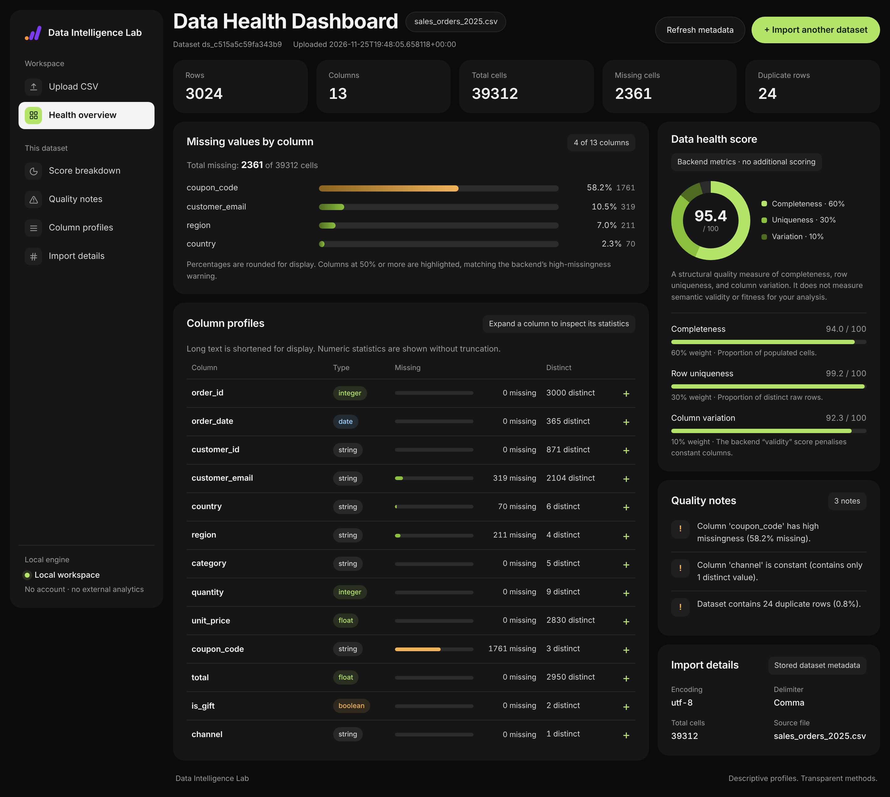
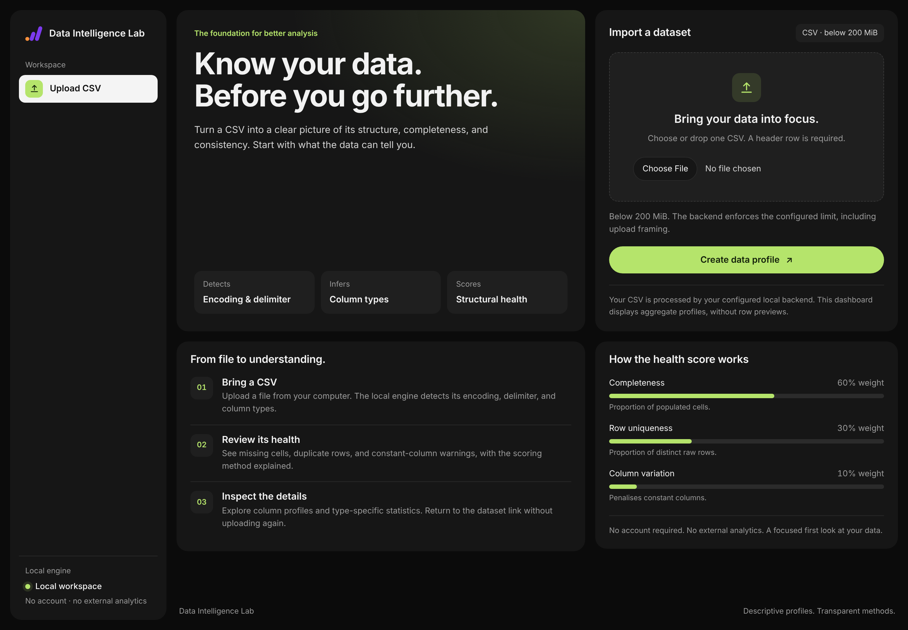
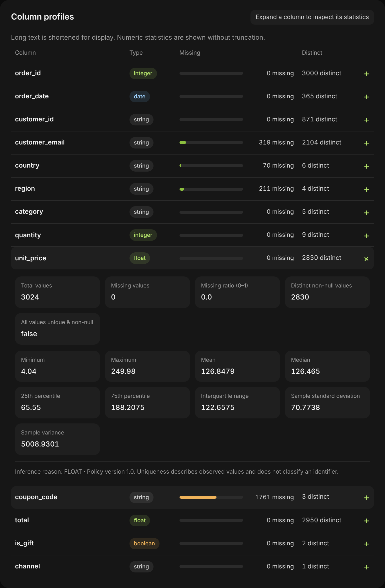
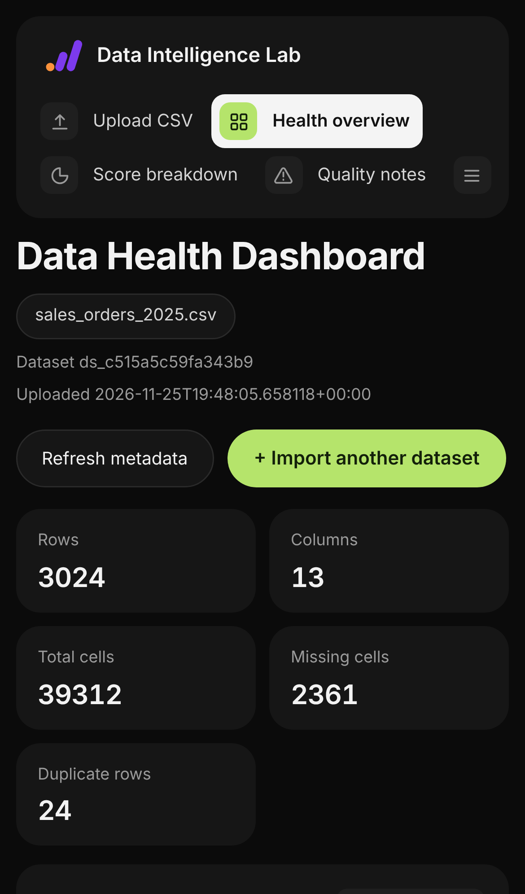

project not finished yet ...

# Data Intelligence Lab

Data Intelligence Lab is an open-source, general-purpose data intelligence platform designed to help people transform raw datasets into transparent, statistically rigorous, and actionable insights.

The platform is designed around a **hybrid operational model**: prioritizing a local-first, privacy-preserving desktop experience for individual analysts, while establishing clean architectural boundaries for future cloud workspaces.

---

## Screenshots

Captured from the current development build running locally (Next.js frontend + FastAPI backend), using a synthetic sample CSV (`sales_orders_2025.csv`, 3,024 rows × 13 columns). All values shown are computed by the real backend for that sample file.

**Data Health Dashboard**: dataset totals, missing values by column, the health score split by its 60/30/10 weights, quality notes and column profiles.



**Upload**: CSV import with the scoring method explained up front.



<table>
  <tr>
    <td width="60%"><strong>Column profile</strong>: an expanded column with its type-specific statistics.<br><br></td>
    <td width="40%"><strong>Mobile</strong>: the sidebar collapses into a top bar.<br><br></td>
  </tr>
</table>

---

## Current Project Status: Milestone 4B-1 Local API Boundary Implemented

- **Overall Roadmap Progress:** ~42%
- **Domain Core (Phases 1–3):** Implemented and frozen (resource safety, strict CSV parsing, explicit type inference and statistical profiling).
- **Persistence Adapter (Milestone 4A):** Implemented and frozen (atomic Parquet + metadata persistence).
- **Local API Boundary (Milestone 4B-1):** Implemented (FastAPI delivery layer, `IExecutionAdapter` port, `LocalExecutionAdapter`, RFC 7807 error boundary).
- **Automated Tests** (verified 25 November 2026, Linux, Python 3.13, Node 22; backend re-verified on commit `a943f2b`): all suites pass, 1,271 tests, 0 failed. CI (GitHub Actions) runs `pytest` on Python 3.12 and 3.13 plus the frontend lint, typecheck, build and proxy tests on every pull request. Milestone 4B-1 remediation awaits independent acceptance; it is not frozen.

  | Suite | Command | Result |
  | --- | --- | --- |
  | Backend unit, integration & worker contract | `pytest` | 1,194 passed, 0 failed, 0 warnings |
  | Frontend UI (mocked API) | `npm test` | 36 passed |
  | Frontend ↔ real backend end-to-end | `npm run test:real` | 6 passed |
  | API proxy & security | `npm run test:proxy` | 35 passed, 0 failed |
  | Lint, type check, production build | `npm run lint`, `typecheck`, `build` | All pass |

  The Playwright configs launch the server with `npm.cmd` (Windows). The Linux run above used a temporary, uncommitted config override for the start command and the browser path; the tests themselves were unchanged.
- **Documentation:**
  - [Product Definition](docs/01-product-definition.md): Vision, user personas, 8-stage analytical pipeline, measurable acceptance criteria, and non-goals.
  - [Architecture Specification](docs/02-architecture.md): Hexagonal architecture, C4 diagrams, request lifecycle, OWASP ASVS 5.0.0 Level 2 baseline, and ADRs.

---

## Local Environment & Running the Server

### Prerequisites
- **Python:** 3.12 (64-bit)
- **Git:** 2.x+

### Setup
1. **Activate the Virtual Environment:**
   - **Windows (PowerShell):** `.\.venv\Scripts\Activate.ps1`
   - **Windows (CMD):** `.\.venv\Scripts\activate.bat`
   - **Linux / macOS:** `source .venv/bin/activate`

2. **Install Dependencies:**
   ```bash
   pip install -r requirements.txt
   ```

3. **Run the Test Suite:**
   ```bash
   pytest -v
   ```

### Starting the Local API Gateway

Launch the local API gateway bound strictly to loopback (`127.0.0.1`):

```bash
uvicorn backend.main:app --host 127.0.0.1 --port 8000
```
or via the launcher entry point:
```bash
python -m backend.main
```

> **Security Note:** The supplied Python launcher (`python -m backend.main`) validates and canonicalizes loopback IP literals before starting Uvicorn. The default is `127.0.0.1`; IPv4 loopback addresses in `127.0.0.0/8`, IPv6 `::1` (including bracketed/expanded forms), and IPv4-mapped loopback literals accepted by Python's `ipaddress` are supported. Wildcards, LAN/public addresses, hostnames, malformed values, and whitespace are rejected. This guard does not control the bind arguments of an independently configured external Uvicorn invocation; use explicit loopback arguments for that invocation.

### Implemented Endpoints (Milestone 4B-1)

| Method | Endpoint | Description | Success Code |
| :--- | :--- | :--- | :--- |
| `GET` | `/health` | Liveness probe (no I/O or storage dependencies) | `200 OK` |
| `GET` | `/ready` | Readiness probe (verifies storage subsystem writability) | `200 OK` / `503` |
| `POST` | `/api/v1/datasets/upload` | Streamed multipart CSV upload & profiling (pre-spool byte budget enforced) | `201 Created` |
| `GET` | `/api/v1/datasets/{dataset_id}` | Retrieve stored schema, metadata, and profile | `200 OK` |
| `DELETE` | `/api/v1/datasets/{dataset_id}` | Recursively remove dataset directory and artifacts from storage (recursive, non-atomic) | `204 No Content` |

### Bounded Multipart Upload Intake

Upload intake is governed by `BoundedUploadMiddleware` at the ASGI boundary, enforcing the body budget before and during multipart streaming intake:
- **Limit Precedence:** The effective budget is the minimum of every valid applicable cap: `min(required_settings_cap, all_present_adapter_caps)`. The Settings cap (`settings.max_upload_bytes`) is strictly required and never optional. Both adapter attributes (`adapter.limits.max_bytes` and `adapter.max_upload_bytes`) remain supported and are optional only when absent/`None`; a larger alias never overrides a smaller limit. If the required Settings cap is missing or mutated to an invalid value (such as `None`), the upload request fails closed with a safe 500 problem response before parser intake, rather than silently omitting it or falling back to an adapter cap. The budget covers the entire multipart body, including framing.
- **Configuration Contract:** Programmatic caps must be plain integers from 1 through `sys.maxsize` bytes. Booleans, floats, numeric strings, zero, negative values, and larger integers are rejected. `MAX_UPLOAD_BYTES` accepts only ASCII decimal digits in the same range; an absent variable selects the default, while an empty or invalid value fails configuration. Validation occurs during app construction and again per upload request before parser forwarding, ensuring runtime mutations to invalid caps fail closed safely.
- **Receive-Time ASGI Protection:** Incoming requests exceeding the effective budget are rejected early via pre-flight `Content-Length` inspection or during dynamic `receive()` metering before the crossed message reaches Starlette's multipart parser or creates unbounded disk spools. Requests crossing the limit are rejected immediately with `413 Payload Too Large` (`ERR_FILE_SIZE_LIMIT_EXCEEDED`), further consumption of request chunks is halted, and any partial temporary spools are closed upon rejection and client cancellation.
- **Transport Scope:** Receive-time ASGI enforcement protects parser and spool intake, but does not establish a hard memory bound on the underlying ASGI server (e.g., Uvicorn) or network transport layer.

### Error Boundary (RFC 7807)

All domain, storage, and HTTP errors crossing the delivery boundary return standard `application/problem+json` envelopes conforming to RFC 7807:

```json
{
  "type": "about:blank",
  "title": "Malformed CSV",
  "status": 422,
  "detail": "The dataset contains malformed CSV.",
  "instance": "/api/v1/datasets/upload",
  "code": "ERR_MALFORMED_CSV"
}
```

The delivery error handlers select public messages and codes from application-controlled mappings:
- **Controlled Categories:** Domain/storage categories have fixed titles, messages, and codes. Generic storage failures use `ERR_STORAGE_FAILED`; unexpected failures use `ERR_INTERNAL_SERVER_ERROR`. Dataset error details are generic and omit exception-supplied identifiers.
- **Structured Size Details:** A 413 response may include independently validated plain integer byte counts. Mutated messages, subclasses, safety flags, custom formatters, and exception-supplied codes cannot supply response text.
- **HTTP Errors:** Only integer error statuses from 400 through 599 (or standard `HTTPStatus` values) are accepted. Invalid status types/values become a generic 500. Titles/details use canonical phrases, with `HTTP Error` for unassigned statuses. HTTP 404 maps to `ERR_NOT_FOUND`; other ordinary HTTP errors use `ERR_HTTP_ERROR`. Exception detail strings and `is_safe_public` flags are ignored, including string subclasses.
- **Validation:** Validation failures use a fixed public message/code, without copying `msg`, `input`, `ctx`, field locations, or exception representations. The six-field envelope retains `instance` as the client's request path, not an internal exception path.
- **Internal Diagnostics:** Exception diagnostics are sent only to the configured server-side logger. Logs may contain sensitive diagnostic information and must remain appropriately protected. No outbound telemetry integration was introduced.

Browser-side CDN assets used by documentation or UI mockups are separate from the local API runtime. The inspected backend has no outbound telemetry integration or CDN runtime dependency. System-wide network-egress enforcement is outside this milestone.

---

## Repository Structure

```text
Data Intelligence Lab/
├── core/                  # Pure Python domain logic (ingestion, profiling, statistics, quality)
├── backend/               # FastAPI delivery application, route handlers, local storage adapter
├── tests/
│   ├── unit/              # Isolated domain tests for mathematical correctness
│   ├── integration/       # API route, storage, and engine integration tests
│   └── fixtures/          # Benchmark and test dataset files
├── docs/
│   ├── 01-product-definition.md  # Formal product requirements and non-goals
│   └── 02-architecture.md        # Technical architecture, security, and ADRs
├── .gitignore             # Comprehensive development exclusions
├── README.md              # Project overview and setup documentation
└── SECURITY.md            # Security policy, reporting procedure, and baseline
```

---

## License

Open-source license to be specified upon first public release.
