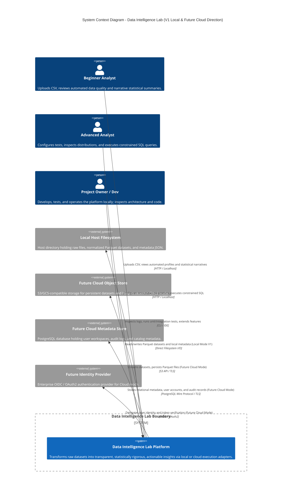
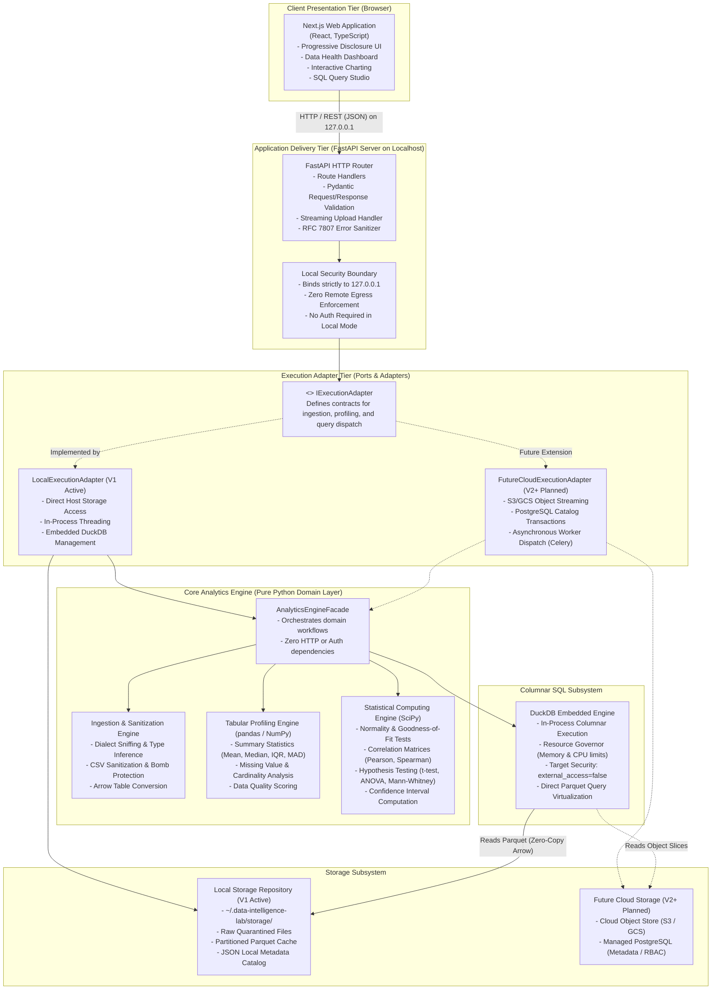
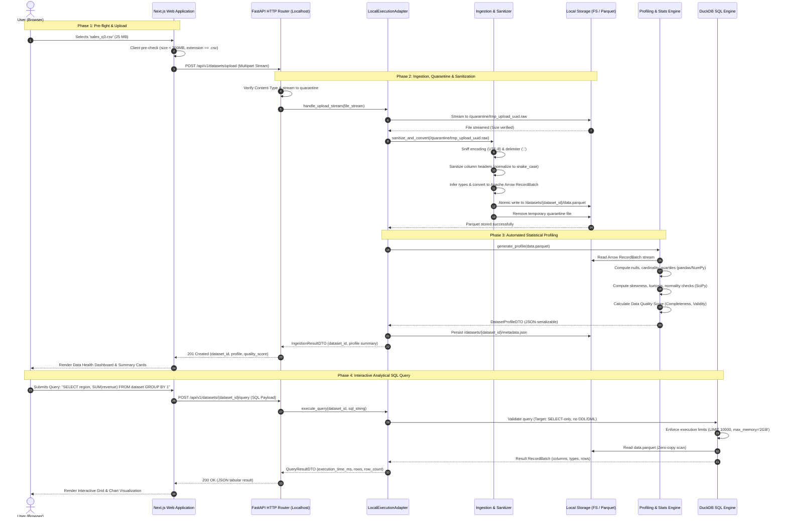
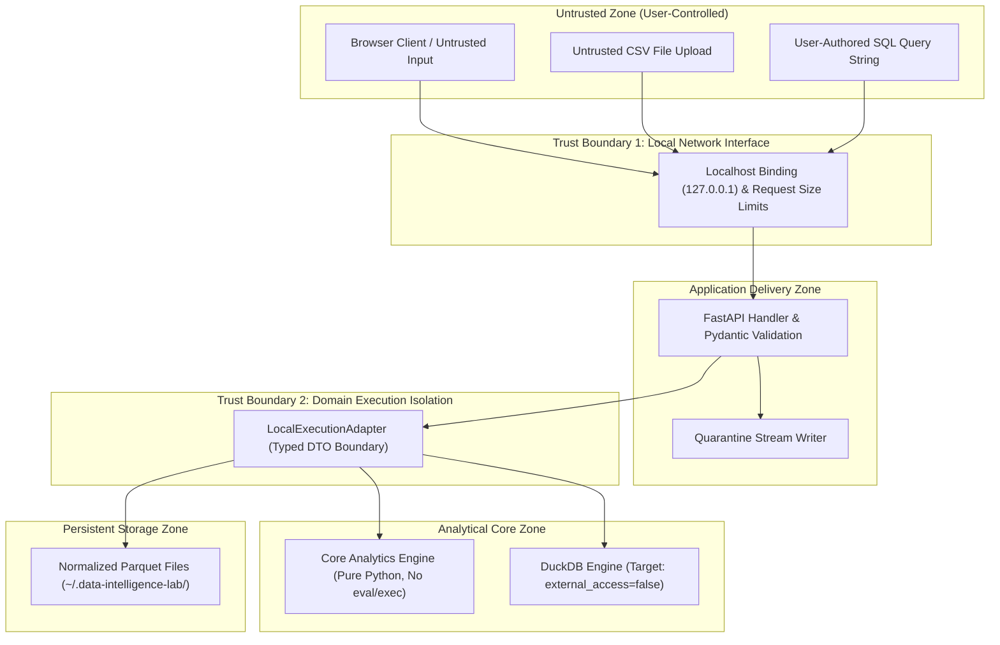
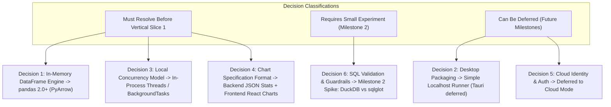

# Architecture Specification: Data Intelligence Lab

**Document Identifier:** `DOC-ARCH-002`  
**Document Status:** Architecture Specification Baseline (Design Milestone — No Code Implemented)  
**System Name:** Data Intelligence Lab  
**Target Milestone:** Architecture Documentation (V1 Foundation)  
**Reference Product Definition:** [`docs/01-product-definition.md`](file:///c:/Users/User/Desktop/Youssef%20Manssouri/Data%20Intelligence%20Lab/docs/01-product-definition.md)  
**Author / Project Lead:** Youssef Manssouri  

---

## Table of Contents

1. [Architectural Goals and Non-Goals](#1-architectural-goals-and-non-goals)
2. [System Context Architecture (C4 Level 1)](#2-system-context-architecture-c4-level-1)
3. [Container and Component Architecture (C4 Levels 2 & 3)](#3-container-and-component-architecture-c4-levels-2--3)
4. [Component Responsibilities and System Boundaries](#4-component-responsibilities-and-system-boundaries)
5. [End-to-End Request Lifecycle: Importing and Analyzing a CSV Dataset](#5-end-to-end-request-lifecycle-importing-and-analyzing-a-csv-dataset)
6. [Execution Models: Local-First vs. Future Cloud Execution](#6-execution-models-local-first-vs-future-cloud-execution)
7. [System Interfaces and Data Contracts](#7-system-interfaces-and-data-contracts)
8. [Dataset Ownership, Metadata Ownership, and Storage Boundaries](#8-dataset-ownership-metadata-ownership-and-storage-boundaries)
9. [Error Handling, Observability, and Testing Strategy](#9-error-handling-observability-and-testing-strategy)
10. [Security Architecture, Trust Boundaries & Threat Modeling (OWASP ASVS 5.0.0 Level 2 Baseline)](#10-security-architecture-trust-boundaries--threat-modeling-owasp-asvs-500-level-2-baseline)
11. [Architectural Decision Records (ADRs) and Learning Guides](#11-architectural-decision-records-adrs-and-learning-guides)
12. [Actionable Resolution of Architecture Decisions (Pre-Implementation Gate)](#12-actionable-resolution-of-architecture-decisions-pre-implementation-gate)

---

## 1. Architectural Goals and Non-Goals

### 1.1 Context and Architectural Principles
Data Intelligence Lab is an open-source, general-purpose data intelligence platform designed to help users transform raw datasets into transparent, statistically rigorous, actionable insights.

The platform architecture is designed around four core engineering principles:
1. **Separation of Concerns:** The mathematical and analytical engine must be completely decoupled from HTTP transport frameworks, database drivers, and frontend UI components.
2. **Progressive Disclosure:** Beginner analysts receive intuitive, automated data quality narratives and summaries; advanced researchers have full access to underlying distributions, statistical parameters, and analytical SQL.
3. **Local-First Simplicity for V1:** The initial implementation must prioritize local execution on a single workstation, maintaining minimal operational friction and high feasibility for a developer learning Python.
4. **Clean Abstraction for Cloud Portability:** Future cloud capabilities (multi-tenancy, object storage, background workers) must integrate via clean execution adapters without requiring rewrites of the core analytical logic.

### 1.2 Architectural Goals
The architecture must satisfy the following explicit goals:

1. **Local-First Analytical Execution:** The primary execution target for V1 is local-first. Datasets processed locally reside on the host filesystem and execute without requiring cloud services, external accounts, or external network connectivity.
2. **Decoupled Analytical Engine (Hexagonal Architecture):** The domain logic (profiling, quality scoring, hypothesis testing, correlation) is packaged as pure Python modules with zero dependencies on web frameworks (`FastAPI`), network libraries, or authentication mechanisms.
3. **Execution Adapter Parity:** The same analytical domain operations must be callable by both the V1 `LocalExecutionAdapter` and a future `CloudExecutionAdapter`.
4. **Robust Defense for Untrusted Inputs:** Every uploaded file (CSV) and user query is treated as untrusted input. The system enforces size limits, streaming ingestion, cell-width boundaries, and delimiter/encoding sniffing.
5. **Zero Arbitrary Code Execution:** The platform strictly prohibits the execution of user-supplied Python, R, or shell code. Dynamic execution primitives (`eval()`, `exec()`) are banned.
6. **Constrained Columnar SQL Engine:** Analytical SQL queries are executed via an embedded DuckDB engine governed by resource controls (memory ceilings, timeouts, row limits) and capability restrictions (external network and filesystem access disabled).
7. **Feasibility for Developer Learning:** The architecture avoids distributed systems, microservices, Kubernetes, and enterprise messaging infrastructure for V1, providing an understandable, cohesive modular monolith.

### 1.3 Architectural Non-Goals (Scope Constraints)
To maintain delivery focus and feasibility, the following are explicitly declared non-goals for V1:

- **Non-Goal 1: No Generative AI or LLM Wrappers:** No OpenAI/LLM API calls for text generation in the analytical core. Insight summaries must be deterministic and mathematically verifiable.
- **Non-Goal 2: No Machine Learning or Predictive Modeling:** No model training, neural networks, or AutoML in V1. Focus is on descriptive, diagnostic, and inferential statistics.
- **Non-Goal 3: No Time-Series Forecasting:** No ARIMA, Prophet, or predictive extrapolations.
- **Non-Goal 4: No Arbitrary Python Code Sandboxing:** The platform is an analytical application, not a general-purpose programming notebook (e.g., Jupyter).
- **Non-Goal 5: No Real-Time Streaming Telemetry:** No Kafka or real-time event streaming; processing is batch-oriented for discrete tabular files.
- **Non-Goal 6: No Multi-User Accounts or Auth in Local Mode:** Local mode does not implement authentication, password hashing, or user registration.
- **Non-Goal 7: No Distributed Cluster Infrastructure:** No Spark, Dask, Ray, or Kubernetes clusters. Datasets are sized to fit local disk and memory limits.

---

## 2. System Context Architecture (C4 Level 1)

The System Context diagram illustrates the system boundaries, human actors, and external system relationships across both V1 local mode and the future cloud operating model.

### 2.1 Actors
- **Beginner Analyst / Business User:** Interacts through a web browser to upload tabular data, view automated data health ratings, and consume plain-English statistical findings.
- **Advanced Analyst / Quantitative Researcher:** Configures hypothesis tests, inspects raw distributions and variance metrics, and issues analytical SQL queries.
- **Project Owner / Lead Developer:** Builds, inspects, tests, and maintains the platform while mastering Python backend development, scientific computing, and system architecture.

### 2.2 System Context Diagram (Mermaid)



---

## 3. Container and Component Architecture (C4 Levels 2 & 3)

The architecture follows a **Hexagonal Architecture** (Ports and Adapters) pattern organized as a modular monolith.

### 3.1 Architecture Overview & Topology
- **Frontend Container:** Next.js (React, TypeScript) executing in the user's browser, providing a progressive disclosure interface.
- **Backend API Container:** FastAPI (Python) executing as a local server process, handling HTTP requests, streaming file ingestion, and payload serialization.
- **Execution Adapter Boundary:** Decouples the API delivery layer from storage and compute environments.
- **Core Analytics Engine:** Pure, headless Python domain package holding all data profiling, quality scoring, and statistical logic.
- **Analytical SQL Subsystem:** Embedded DuckDB process running within the backend runtime, restricted to read-only query operations on normalized Parquet files.
- **Storage Subsystem:** Local filesystem storage under `~/.data-intelligence-lab/storage/` for V1.

### 3.2 Container Topology Diagram (Mermaid)



---

## 4. Component Responsibilities and System Boundaries

### 4.1 Next.js Frontend Application
- **Responsibilities:**
  - Provide an intuitive graphical interface using **Progressive Disclosure** (executive health scores upfront; statistical formulas and parameters on demand).
  - Perform client-side pre-flight checks (file size limits, supported file extensions) for immediate user feedback.
  - Render responsive charts (histograms, box plots, correlation heatmaps) from structured statistical summary payloads sent by the backend.
  - Provide an interactive SQL query editor with syntax highlighting and tabular results display.
- **Boundaries & Anti-Responsibilities:**
  - The frontend must never perform mathematical or statistical calculations. All p-values, confidence intervals, and metrics originate from the backend engine.
  - Client-side checks are purely for UX; the backend treats all incoming requests as untrusted.

### 4.2 FastAPI Application Layer
- **Responsibilities:**
  - Serve as the HTTP delivery gateway, binding strictly to `127.0.0.1` in local mode.
  - Enforce strict request schema validation using Pydantic V2 models.
  - Handle streamed multipart file uploads and save them into the storage quarantine.
  - Translate domain exceptions into standard **RFC 7807 Problem Details** JSON payloads.
  - Redact internal server stack traces and host filesystem paths from all client responses.
- **Boundaries & Anti-Responsibilities:**
  - Route handlers must not import `pandas`, `scipy`, or `duckdb` directly; they only interact with the `IExecutionAdapter` interface.
  - The API layer is completely stateless and requires no user authentication in local mode.

### 4.3 Execution Adapter Layer (`IExecutionAdapter`)
- **Responsibilities:**
  - Mediate between the delivery layer and the underlying compute/storage environment.
  - Implemented interface `backend.ports.IExecutionAdapter`:
    - `ingest_and_store(file_source, filename, dataset_id, limits, policy) -> Dict[str, Any]`
    - `get_dataset_metadata(dataset_id) -> Dict[str, Any]`
    - `delete_dataset(dataset_id) -> bool`
    - `check_storage_readiness() -> bool`
  - `LocalExecutionAdapter` (Milestone 4B-1 Implemented):
    - Pure Python adapter with zero web/HTTP framework dependencies.
    - Orchestrates pure domain ingestion via `core.ingest_csv()` and persists normalized Parquet (`data.parquet`) and metadata (`metadata.json`) via `LocalDatasetStorage`.
    - Generates collision-resistant dataset IDs (`ds_<16 hex digits>`) adhering strictly to the authoritative storage validation contract.
    - Performs filesystem storage readiness probes without leaking system internals.
  - `FutureCloudExecutionAdapter` (V2+ Planned): Will manage tenant authorization contexts, stream datasets to/from S3/GCS, record metadata in PostgreSQL, and dispatch heavy tasks to Celery/Redis workers.
- **Boundaries & Anti-Responsibilities:**
  - Adapters must never modify the statistical algorithms; they only handle environment coordination.
  - `IExecutionAdapter` is an application execution port, strictly isolated from FastAPI types, HTTP status codes, request objects, `UploadFile`, and response models.


### 4.4 Core Analytics Engine (Pure Python Domain)
- **Responsibilities:**
  - **Ingestion & Normalization:** Detect character encodings (UTF-8, Latin-1) and delimiters (comma, semicolon, tab); sanitize column names; enforce cell-size limits; infer primitive data types; and output standardized Apache Parquet files.
  - **Data Profiling:** Compute complete column profiles: completeness, null counts, distinct cardinality, distribution quartiles, IQR, MAD, skewness, and kurtosis.
  - **Data Quality Scoring:** Compute a deterministic 0–100 Data Health Score based on completeness, uniqueness, type conformity, and anomaly density.
  - **Statistical Computing:** Execute hypothesis tests via SciPy (Shapiro-Wilk / D'Agostino normality tests, Pearson/Spearman correlations with p-values, t-tests, Mann-Whitney U, ANOVA).
- **Boundaries & Anti-Responsibilities:**
  - Zero imports of `fastapi`, `starlette`, or HTTP-related libraries.
  - Zero execution of user-supplied code or dynamic Python expressions.

### 4.5 Analytical SQL Subsystem (DuckDB Embedded Engine)
- **Responsibilities:**
  - Execute vectorized, in-process columnar SQL queries against normalized Parquet datasets.
  - Provide fast filtering, grouping, and projection for tabular data exploration.
- **Boundaries & Anti-Responsibilities:**
  - Target security configuration: external filesystem traversal disabled (`enable_external_access = false`), memory capped (`max_memory = '2GB'`), and queries restricted to read-only analytical statements.
  - DuckDB is used strictly as an OLAP analytical engine, not for application transaction management.

### 4.6 Storage Subsystem
- **Responsibilities:**
  - Manage the lifecycle of raw quarantined files, permanent normalized Parquet files, and metadata JSON documents.
  - **Milestone 4A Current Guarantees:**
    - **No-overwrite behavior:** Re-publishing an existing `dataset_id` is rejected (`DatasetAlreadyExistsError`).
    - **Artifact presence validation:** Requires both `data.parquet` and `metadata.json` for dataset validity.
    - **Isolated staging:** Writes occur in isolated staging directories (`.tmp_{uuid}_{dataset_id}`).
    - **Atomic publication:** Staging directories are renamed into place (`replace()`) only once both files are fully written. Note: atomic publication provides atomic directory replacement; it does not provide cryptographic integrity or power-loss durability.
    - **Failure cleanup on a best-effort basis:** Staging artifacts are cleaned up if an error occurs, without masking primary storage exceptions.
  - **Deferred Controls (Post-4A Hardening Milestone):**
    - OS-level read-only file enforcement on published dataset artifacts.
    - SHA-256 cryptographic checksum generation and read-time verification.
- **Boundaries & Anti-Responsibilities:**
  - The storage subsystem does not perform data transformations; it handles persistence and atomic I/O.

---

## 5. End-to-End Request Lifecycle: Importing and Analyzing a CSV Dataset

### 5.1 Request Lifecycle Sequence Diagram (Mermaid)



### 5.2 Phase-by-Phase Execution Details

1. **Pre-flight & Upload:** The browser checks that the file ends in `.csv` and does not exceed the maximum allowed size (e.g., 200 MB default). It streams the file via multipart HTTP to `http://127.0.0.1:8000/api/v1/datasets/upload`.
2. **Quarantine & Dialect Sniffing:** The server streams chunks directly into a temporary file in `~/.data-intelligence-lab/storage/quarantine/`. The ingestion engine samples the first 64 KB to detect encoding and delimiters, enforces a 32 KB maximum cell length to protect against CSV expansion attacks, sanitizes column names to standard identifiers, and converts the data into an immutable Apache Parquet file. The raw quarantine file is unlinked.
3. **Statistical Profiling & Quality Scoring:** The engine reads the Parquet file and calculates column-level completeness, uniqueness, five-number summaries, skewness, and kurtosis. It computes the 0–100 Data Health Score and saves the resulting `metadata.json` alongside the Parquet file.
4. **Interactive SQL & Hypothesis Testing:** When the user issues an analytical query or triggers a hypothesis test, the request is dispatched to DuckDB or SciPy. Output results are enveloped in standardized JSON payloads containing test statistics, p-values, sample sizes, and degrees of freedom.

---

## 6. Execution Models: Local-First vs. Future Cloud Execution

### 6.1 Concrete Local Deployment Model (V1)
The local execution model is designed for straightforward execution on a developer workstation or end-user PC:

- **Runtime Architecture:**
  - **Backend Server:** Python 3.11+ running FastAPI via `uvicorn app.main:app --host 127.0.0.1 --port 8000`.
  - **Frontend Server:** Next.js development server running on `http://127.0.0.1:3000` (proxying `/api` requests to port 8000), or a static Next.js production build served directly by FastAPI.
  - **Single Command Startup:** In development, started via a unified script (e.g., `npm run dev` or a Python launch script).
- **Concurrency Model for V1:** Small to medium datasets (<50 MB) profile in 1–5 seconds. Tasks run synchronously or dispatch via standard Python `threading.Thread` / FastAPI `BackgroundTasks`. Complex message brokers (Celery, Redis) are omitted.
- **Storage Path:** Direct host filesystem storage rooted at `~/.data-intelligence-lab/storage/`.
- **Authentication:** None. Local single-user mode has no login, no accounts, and no session management.
- **UI & CDN Asset Decoupling:** External documentation/UI assets are browser-side presentation dependencies. The inspected local API has no CDN runtime dependency or outbound telemetry integration. System-wide egress enforcement is outside Milestone 4B-1.

### 6.2 Future Cloud Execution Model (V2+)
- **Runtime Architecture:** Stateless FastAPI containers deployed behind a cloud load balancer; Next.js frontend hosted via CDN/edge storage.
- **Concurrency Model:** Heavy profiling and complex queries are offloaded to distributed worker queues (Celery/Redis or temporal workers).
- **Storage Subsystem:** Raw datasets and Parquet assets reside in cloud object storage (S3/GCS); catalog metadata, user workspaces, and audit trails reside in managed PostgreSQL.
- **Authentication & Multi-Tenancy:** Server-side OAuth2/OIDC authentication with JWT session tokens and strict tenant-scoped RBAC.

### 6.3 Comparative Matrix

| Architectural Dimension | Local Execution Model (V1 Baseline) | Future Cloud Model (V2+ Direction) |
| :--- | :--- | :--- |
| **Primary Deployment** | Single local machine (`127.0.0.1:8000` / `3000`) | Containerized cluster (Docker / ALB / CDN) |
| **User Audience** | Solo analyst, developer learning stack | Distributed teams, enterprise organizations |
| **Execution Adapter** | `LocalExecutionAdapter` | `FutureCloudExecutionAdapter` |
| **Task Concurrency** | In-process threads / `BackgroundTasks` | Asynchronous worker queue (Celery / Redis) |
| **SQL Engine** | In-process embedded DuckDB instance | Containerized worker DuckDB / MotherDuck |
| **Tabular Storage** | Local filesystem (`~/.data-intelligence-lab/`) | Cloud Object Storage (S3 / GCS) |
| **Metadata Storage** | Local `metadata.json` files | Managed PostgreSQL relational database |
| **Authentication** | None (Implicit OS workstation user) | Server-side OAuth2 / OIDC / JWT with RBAC |
| **Network Egress** | Zero external network transmission | Outbound TLS to cloud storage and auth |

---

## 7. System Interfaces and Data Contracts

### 7.1 Frontend to Backend REST API Endpoints (Milestone 4B-1 Implemented Baseline)
All endpoints return JSON responses. Errors follow **RFC 7807 Problem Details** (`application/problem+json`).
The supplied Python launcher validates and canonicalizes loopback literals before starting Uvicorn. Its default is `127.0.0.1`; it supports `127.0.0.0/8`, `::1` (including bracketed/expanded forms), and IPv4-mapped loopback literals classified by Python's `ipaddress`. Wildcards, private/LAN/public IPs, hostnames, malformed values, and whitespace are rejected. The guard does not control independently supplied external Uvicorn bind arguments.

#### Implemented Endpoints (Milestone 4B-1)
- `GET /health`
  - *Purpose:* Liveness probe confirming that the HTTP server process is running.
  - *Isolation:* Strictly isolated; performs no disk I/O, storage checks, or network operations.
  - *Response (200 OK):* `{"status": "ok"}`
- `GET /ready`
  - *Purpose:* Readiness probe confirming storage subsystem availability and writability.
  - *Response (200 OK):* `{"status": "ready"}`
  - *Failure (503 Service Unavailable):* RFC 7807 problem details with `code: "ERR_STORAGE_NOT_READY"`.
- `POST /api/v1/datasets/upload`
  - *Payload:* `multipart/form-data` with `file=<CSV>`.
  - *Intake Budget & Pre-Spooling Protection:* `BoundedUploadMiddleware` enforces the minimum of all valid applicable caps: `min(required_settings_cap, all_present_adapter_caps)`. `settings.max_upload_bytes` is strictly required (never optional); only adapter attributes are optional when absent/`None`. Neither adapter attribute overrides the other. Caps cover multipart framing as well as file contents. All configured values must be plain integers from 1 through `sys.maxsize`; booleans/floats/numeric strings are invalid programmatic values. The environment accepts ASCII decimal digits in the same range; absent `MAX_UPLOAD_BYTES` defaults to 200 MiB, while empty/invalid values fail configuration. Validation occurs at construction and on every upload request before parser forwarding; an invalid or missing Settings cap fails closed with a safe 500 problem response before parser intake. Oversized Content-Length or a crossing received message triggers RFC 7807 413 (`ERR_FILE_SIZE_LIMIT_EXCEEDED`) before that message reaches the parser; later messages are not consumed. Installed Starlette cleanup closes partial spools on receive failure, parse failure, and cancellation. Receive-time protection does not establish a hard memory bound on the ASGI server or transport.
  - *Streaming Processing:* Streams the underlying binary file stream directly to `ingest_csv()` without buffering into RAM via `await file.read()`.
  - *Response (201 Created):* `{"dataset_id": "ds_...", "filename": "data.csv", "created_at": "...", "row_count": 100, "column_count": 5, "data_quality_score": 92.5}`
- `GET /api/v1/datasets/{dataset_id}`
  - *Response (200 OK):* Complete stored metadata dictionary including column schemas, types, and statistical profiles.
  - *Failure (404 Not Found):* RFC 7807 with `code: "ERR_DATASET_NOT_FOUND"`.
  - *Failure (400 Bad Request):* RFC 7807 with `code: "ERR_INVALID_DATASET_ID"` (e.g. path traversal or reserved names).
- `DELETE /api/v1/datasets/{dataset_id}`
  - *Response (204 No Content):* Persistent artifacts (`data.parquet`, `metadata.json`) and dataset directory recursively removed from host filesystem (deletion is recursive and non-atomic).
  - *Failure (404 Not Found):* RFC 7807 with `code: "ERR_DATASET_NOT_FOUND"`.

#### Planned Future Endpoints (Milestone 4B-2+)
- `POST /api/v1/datasets/{dataset_id}/query` (DuckDB SQL execution)
- `POST /api/v1/datasets/{dataset_id}/statistical-test` (SciPy hypothesis testing)


### 7.2 Core Analytics Python Protocol
The core analytics engine accepts native Python/Arrow data structures and returns pure dataclasses:

```python
# Pure domain contracts (core/contracts.py)
from dataclasses import dataclass
from typing import List, Dict, Any, Optional
import pyarrow as pa

@dataclass(frozen=True)
class ColumnProfile:
    name: str
    inferred_type: str
    null_count: int
    completeness_ratio: float
    distinct_count: int
    is_unique: bool
    summary_stats: Dict[str, float]

@dataclass(frozen=True)
class DatasetProfileResult:
    dataset_id: str
    row_count: int
    column_count: int
    data_quality_score: float
    columns: List[ColumnProfile]
```

---

## 8. Dataset Ownership, Metadata Ownership, and Storage Boundaries

### 8.1 Data Categorization & Separation
1. **Quarantine Storage (`/quarantine/`):** Ephemeral storage holding raw uploaded files during ingestion. Files are strictly isolated and deleted immediately after conversion.
2. **Normalized Dataset Storage (`/datasets/{id}/data.parquet`):** Immutable, strongly-typed Parquet files serving as the single analytical source of truth.
3. **Derived Metadata (`/datasets/{id}/metadata.json`):** Calculated column profiles, quality metrics, and schema definitions.
4. **Temporary Query Cache (`/cache/`):** Ephemeral query outputs, discarded after session termination.

### 8.2 Local Storage Directory Hierarchy

```text
~/.data-intelligence-lab/
├── storage/
│   ├── quarantine/                     <-- Ephemeral, strictly isolated uploads
│   │   └── tmp_upload_uuid.raw
│   ├── datasets/                       <-- Authoritative dataset storage
│   │   ├── ds_01h8x9p2q1m4/
│   │   │   ├── data.parquet            <-- Normalized columnar dataset (Snappy/ZSTD)
│   │   │   └── metadata.json           <-- Profile, schema, statistical metrics
│   │   └── ds_01h8x9p3r8k2/
│   │       ├── data.parquet
│   │       └── metadata.json
│   └── cache/                          <-- Temporary query result sets
└── logs/
    └── execution.log                   <-- Structured JSON application log
```

---

## 9. Error Handling, Observability, and Testing Strategy

### 9.1 RFC 7807 Problem Details Error Envelopes
All error responses return standard `application/problem+json` envelopes:

```json
{
  "type": "https://data-intelligence-lab.org/errors/insufficient-variance",
  "title": "Cannot Compute Normality Test",
  "status": 422,
  "detail": "Column 'status' contains a single constant value across all 1,200 rows.",
  "instance": "/api/v1/datasets/ds_01h8x9p2q1m4/statistical-test",
  "code": "ERR_STAT_ZERO_VARIANCE"
}
```

### 9.2 Safe Error Policy & RFC 7807 Error Boundary
- Domain/storage error categories select fixed application-owned titles, messages, and codes. Generic storage failures use `ERR_STORAGE_FAILED`; unexpected failures use `ERR_INTERNAL_SERVER_ERROR`. Exception messages, codes, safety flags, and dataset identifiers are not response text.
- Size errors may include reconstructed byte counts only after exact built-in integer and range validation. Subclass messages and custom formatters are never trusted.
- Ordinary HTTP exceptions use canonical status phrases. Only plain integer statuses from 400 through 599 or standard `HTTPStatus` values are accepted; malformed statuses become a generic 500. HTTP 404 maps to `ERR_NOT_FOUND`; other valid HTTP errors use `ERR_HTTP_ERROR`. Unassigned status phrases use `HTTP Error`. No exception-detail string or string-subclass equality authorizes public content.
- Validation failures use a fixed message/code without copying `msg`, `input`, `ctx`, `loc`, or exception representations. Dataset error details are generic. The six established problem fields remain; `instance` identifies the client's request path.
- Diagnostic exception information is confined to the configured server-side logger. Logs can contain sensitive diagnostics and require appropriate local protection. No outbound telemetry integration is introduced; this is not a claim of system-wide confidentiality or network-egress enforcement.

### 9.3 Observability Framework
- **Structured JSON Logging:** Logs are emitted as structured JSON containing timestamp, severity, module name, and correlation ID.
- **Request Correlation IDs:** Incoming requests receive a unique `X-Correlation-ID` header tracked across route handlers and engine calls.

### 9.4 Testing Boundaries (Pytest)
1. **Unit Tests (Core Domain):** Validate pure statistical calculations against NIST Statistical Reference Datasets (StRD) benchmark values. Zero network, zero disk I/O, executes in milliseconds.
2. **Integration Tests (API & DuckDB):** Use FastAPI `TestClient` to verify HTTP contracts, Parquet generation, and DuckDB query execution.
3. **Adversarial Input Tests:** Feed malformed CSVs, huge cell lengths, non-standard delimiters, and invalid SQL strings to verify graceful failure handling.

---

## 10. Security Architecture, Threat Modeling (OWASP ASVS 5.0.0 Level 2 Baseline)

### 10.1 Evaluated Security Baseline: OWASP ASVS 5.0.0 Level 2
The target security baseline for Data Intelligence Lab is **OWASP ASVS 5.0.0 Level 2** (Applications handling sensitive data, business intelligence, or intellectual property). 

> [!IMPORTANT]
> **Configuration Requirements vs. Tested Controls:**  
> The controls listed below represent **architectural specifications and target design constraints**. They have not yet been empirically tested because application code has not been implemented. During implementation, each requirement must be accompanied by automated verification tests.

### 10.2 Level 2 Requirements Evaluation & Justified Exceptions

| ASVS 5.0.0 Category | Level 2 Applicability to Data Intelligence Lab | Implementation Status & Justified Exceptions |
| :--- | :--- | :--- |
| **V1: Architecture** | **Applicable** — Formal threat modeling, trust boundary definition, third-party library inventory. | Specified in this document; dependencies tracked in future `requirements.txt`. |
| **V2: Authentication** | **Deferred / Exception for Local Mode** — Single-user local mode operates on the local workstation without user accounts. | **Justified Exception:** In V1 Local Mode, authentication is N/A. Level 2 authentication (MFA, password rules) is deferred to Future Cloud Mode. |
| **V3: Session Mgmt** | **Deferred / Exception for Local Mode** — Local mode uses stateless direct requests to `localhost`. | **Justified Exception:** Session management is N/A for local mode; deferred to Cloud Mode. |
| **V4: Access Control** | **Partial (Host Boundary)** — Scoping dataset operations to authorized IDs. | In Local Mode, access is governed by host OS file permissions. Cloud Mode will enforce server-side RBAC. |
| **V5: Input Validation** | **Applicable (Critical)** — Strict validation of CSV inputs, file size ceilings, cell length limits, and SQL parameterization. | Target configuration specified; requires empirical fuzz testing during implementation. |
| **V8: Data Protection** | **Applicable** — Isolation of quarantine uploads, Parquet immutability, zero-telemetry local privacy. | Target configuration specified; requires network socket audit tests. |
| **V13: API Security** | **Applicable** — Explicit HTTP methods, RFC 7807 error envelopes, CORS restriction to localhost. | Target configuration specified; requires integration test verification. |
| **V14: Configuration** | **Applicable (Critical)** — Hardening DuckDB, suppressing debug mode, disabling external network access. | Target configuration specified; requires verification of DuckDB settings. |

### 10.3 Trust Boundaries & Threat Modeling (STRIDE)



### 10.4 STRIDE Threat Matrix & Verification Requirements

| STRIDE Threat | Attack Vector | Architectural Mitigation (Target Design) | Verification Requirement (Pre-Implementation Gate) |
| :--- | :--- | :--- | :--- |
| **Spoofing** | Attacker impersonates legitimate user. | Local mode binds strictly to `127.0.0.1`; no remote network listener. Cloud mode will require OIDC/JWT. | Assert server binds exclusively to `127.0.0.1` and refuses non-loopback connections. |
| **Tampering** | Modification of normalized dataset files. | **Milestone 4A Baseline:** Isolated staging, atomic directory publication, no-overwrite protection (`DatasetAlreadyExistsError`), and dual-artifact presence validation (`data.parquet` and `metadata.json`).<br>**Deferred Controls (Hardening Milestone):** OS-level read-only file enforcement and SHA-256 integrity checksum generation/verification in `metadata.json`. | Assert no-overwrite enforcement, atomic staging cleanup, and artifact presence checks on read. Automated tests checking OS file permissions and checksum validation deferred to hardening milestone. |
| **Repudiation** | User denies issuing expensive query or deleting data. | Immutable structured audit log recorded in `~/.data-intelligence-lab/logs/execution.log`. | Integration test verifying log entry emission for every dataset operation. |
| **Information Disclosure** | Local dataset contents leak via network telemetry or error tracebacks. | Zero-telemetry policy; complete suppression of tracebacks; DuckDB error sanitization (RFC 7807). | Test asserting zero outbound network packets and verifying error response sanitization. |
| **Denial of Service** | CSV decompression bomb (e.g. 50GB uncompressed string); recursive Cartesian join in SQL. | 200MB max file size; 32KB max cell limit; DuckDB `max_memory = '2GB'`; 30s query timeout. | Fuzz test with decompression bomb files and infinite SQL queries to verify timeout termination. |
| **Elevation of Privilege** | User supplies Python script; SQL query uses DuckDB to read host files. | **Strict prohibition of user Python execution**; DuckDB `enable_external_access = false`. | Static lint check banning `eval`/`exec`; security test attempting file read via DuckDB SQL. |

### 10.5 DuckDB & SQL Execution: Controls Requiring Empirical Verification
Before declaring the SQL query capability ready for release, the following specific controls must be empirically verified through automated security tests:

1. **External Filesystem & Network Access Restrictions:** Verify that `SET enable_external_access = false;` actively blocks `read_csv()`, `read_parquet()`, `httpfs`, or filesystem traversal attempts within user SQL.
2. **Query Execution Timeouts:** Verify that queries exceeding 30 seconds are forcibly terminated and do not hang the server process.
3. **Memory Limits:** Verify that queries exceeding `max_memory = '2GB'` fail gracefully with an out-of-memory domain error rather than crashing the Python process.
4. **Result-Size Limits:** Verify that queries returning massive result sets are hard-capped at 10,000 rows.
5. **SQL Operation Prohibitions:** Verify that DDL/DML statements (`ATTACH`, `COPY`, `CREATE`, `DROP`, `ALTER`, `INSERT`, `UPDATE`, `DELETE`) are rejected prior to execution.
6. **Data Isolation:** Verify that a query against `dataset_a` cannot inspect or join `dataset_b` unless explicitly authorized.
7. **Resource Exhaustion Mitigation:** Verify that runaway queries (e.g. `CROSS JOIN` Cartesian explosions) trigger memory/timeout limits without exhausting host resources.

### 10.6 Local Mode Privacy: Testable Requirements
Rather than asserting an unverifiable "100% guarantee," the privacy of local mode is governed by three testable engineering requirements:
1. **Network Listener Scope:** The supplied Python launcher enforces the loopback-literal policy described in Section 7.1 before invoking Uvicorn. Independent external Uvicorn invocations control their own bind arguments and must explicitly select loopback.
2. **Outbound Network Telemetry:** No analytical function, library, or error reporter may establish outbound HTTP/TCP connections. Automated integration tests will monitor network sockets during ingestion and query execution to assert zero outbound traffic.
3. **Explicit Consent:** If an optional remote feature is introduced in the future (e.g., checking for application updates), it must require explicit user opt-in and must never transmit dataset rows, column names, or statistical values.

---

## 11. Architectural Decision Records (ADRs) and Learning Guides

The following records capture the foundational decisions governing Data Intelligence Lab, detailing the technical rationale, alternatives evaluated, trade-offs incurred, and educational guidance for the project owner.

---

### ADR-01: Decoupled Domain Analytics Engine (Hexagonal Architecture)

#### What It Means
Hexagonal Architecture isolates core business logic (statistical calculations, data profiling, tabular transformations) from outside technologies such as HTTP frameworks (FastAPI), presentation layers (Next.js), and storage mechanisms.

#### Why It Is Needed
If analytical calculations were embedded inside FastAPI route handlers, the platform would be permanently tied to an HTTP server. Isolating the engine guarantees that the mathematical core remains pure, highly testable, and reusable across local CLI scripts, background workers, and future cloud workers without code duplication.

#### Alternatives Considered
- **Direct FastAPI Route Coupling:** Writing statistical logic directly inside service classes tied to FastAPI `Request` and `Depends`. *Rejected:* Impairs reusability and makes unit testing slow and dependent on HTTP mocks.
- **Microservices:** Splitting analytics into a separate microservice communicating over gRPC. *Rejected:* Introduces unnecessary operational complexity for a V1 local application.

#### Trade-offs Created
- *Pro:* Deterministic, fast unit tests with zero mock HTTP servers.
- *Pro:* Portability between Local and Cloud execution adapters.
- *Con:* Requires defining explicit Data Transfer Objects (DTOs) between layers.

#### Learning Guide for Project Owner
- **Core Concepts:** Separation of Concerns, Hexagonal Architecture, Inversion of Control (IoC).
- **Recommended Reading:** *Clean Architecture* by Robert C. Martin; *Architecture Patterns with Python* by Harry Percival and Bob Gregory.

---

### ADR-02: Next.js, React, and TypeScript for Frontend

#### What It Means
Next.js is a React-based web framework using TypeScript, delivering component-based UI rendering, routing, and compile-time type safety.

#### Why It Is Needed
The user experience demands **Progressive Disclosure**—initially presenting executive data health indicators for beginners, while enabling instant drill-downs into distributions and raw SQL for advanced users. React provides mature charting and tabular UI components, and TypeScript ensures that complex statistical data contracts are type-checked at compile time.

#### Alternatives Considered
- **Streamlit / Gradio:** Rapid Python-only dashboarding tools. *Rejected:* Rigid layout constraints, high latency on complex interactions, and inability to deliver a customized progressive disclosure interface.
- **Vite + React SPA:** Pure client-side application. *Rejected:* Next.js provides standardized routing, asset optimization, and flexible deployment options (static export or Node server).

#### Trade-offs Created
- *Pro:* Layout flexibility, high-performance interactive charting, excellent developer tooling.
- *Con:* Requires maintaining TypeScript alongside Python in the repository.

#### Learning Guide for Project Owner
- **Core Concepts:** Component state management, Progressive Disclosure UI design, TypeScript interface contracts.
- **Recommended Reading:** *Official Next.js Documentation* (App Router); *Designing Interfaces* by Jenifer Tidwell.

---

### ADR-03: Python and FastAPI for Backend API

#### What It Means
FastAPI is a high-performance Python web framework based on standard Python type hints, ASGI, and Pydantic validation.

#### Why It Is Needed
The scientific computing ecosystem is centered in Python (NumPy, SciPy, pandas). Using Python for the backend enables direct in-process interaction with scientific libraries without serialization overhead. FastAPI is chosen for its native async support, automatic OpenAPI 3.1 documentation generation, and strict Pydantic V2 schema enforcement.

#### Alternatives Considered
- **Flask:** Traditional lightweight Python framework. *Rejected:* Lacks native async, lacks built-in Pydantic validation, requires numerous third-party plugins.
- **Django:** Full-featured framework. *Rejected:* Heavyweight, tightly coupled to its row-oriented ORM, unnecessary overhead for an analytical API.

#### Trade-offs Created
- *Pro:* Seamless interoperability with Python scientific packages; automated OpenAPI schema generation.
- *Con:* Python's Global Interpreter Lock (GIL) requires using thread pools or separate processes for CPU-intensive math.

#### Learning Guide for Project Owner
- **Core Concepts:** ASGI vs. WSGI, Asynchronous event loops (`async`/`await`), Pydantic validation.
- **Recommended Reading:** *FastAPI Official Documentation*; *Robust Python* by Patrick Viafore.

---

### ADR-04: DuckDB for Embedded Columnar Analytical SQL

#### What It Means
DuckDB is an embedded, columnar analytical SQL database engine designed for fast Online Analytical Processing (OLAP). It runs entirely inside the host Python process without requiring a separate server daemon.

#### Why It Is Needed
Traditional relational databases (PostgreSQL, SQLite) store data row-by-row, which is slow for analytical aggregations (`SUM`, `AVG`, `GROUP BY`) across millions of records. DuckDB stores data by columns and uses vectorized execution, running analytical queries orders of magnitude faster. It requires zero configuration from the user and queries Parquet files directly with zero-copy memory mapping.

#### Alternatives Considered
- **SQLite:** Standard embedded database. *Rejected:* Row-oriented; performs poorly on large analytical queries and cannot natively query Parquet.
- **Standalone PostgreSQL Server:** Enterprise relational database. *Rejected:* Unacceptable operational overhead for V1 local mode (requires users to install and manage a database server).
- **Pure pandas Querying:** *Rejected:* Complex SQL syntax in pandas is verbose and memory-inefficient compared to DuckDB's streaming, out-of-core engine.

#### Trade-offs Created
- *Pro:* Zero-infrastructure local OLAP execution with modern SQL support.
- *Pro:* Native, zero-copy querying of Parquet files.
- *Con:* Must be carefully configured with memory and access limits to avoid competing with host RAM.

#### Learning Guide for Project Owner
- **Core Concepts:** Row-oriented (OLTP) vs. Columnar (OLAP) storage, Vectorized execution, Memory mapping.
- **Recommended Reading:** *DuckDB: an Embeddable Analytical Database* (VLDB Paper); *Designing Data-Intensive Applications* (Chapter 3) by Martin Kleppmann.

---

### ADR-05: pandas, NumPy, and SciPy for Core Statistical Computing

#### What It Means
NumPy provides vectorized numerical array operations; pandas provides DataFrame wrangling and profiling; SciPy provides dedicated algorithms for scientific hypothesis testing and distribution fitting.

#### Why It Is Needed
Data Intelligence Lab promises statistically rigorous insights. SciPy is the standard for hypothesis testing (t-tests, ANOVA, Mann-Whitney U), distribution fitting, and p-value derivation. NumPy enables vectorized array operations, while pandas provides tabular profiling. These libraries provide a transparent, scientifically vetted foundation.

#### Alternatives Considered
- **Custom Mathematical Algorithms:** Writing statistical formulas from scratch. *Rejected:* Reinventing numerical algorithms introduces numerical instability and precision errors.
- **R Runtime Integration via rpy2:** *Rejected:* Heavy runtime footprint, complex cross-language environment dependencies.

#### Trade-offs Created
- *Pro:* Thoroughly audited, peer-reviewed, scientifically accurate statistical algorithms.
- *Con:* pandas has higher memory overhead than compiled Rust alternatives (mitigated by using Parquet storage).

#### Learning Guide for Project Owner
- **Core Concepts:** Vectorization, Parametric vs. Non-parametric statistical tests, p-values and confidence intervals.
- **Recommended Reading:** *Python for Data Analysis* by Wes McKinney; *Practical Statistics for Data Scientists* by Peter Bruce and Andrew Bruce.

---

### ADR-06: Modular Monolith Topology for V1 (No Microservices, No Kubernetes)

#### What It Means
A modular monolith runs as a single deployable unit, with internal code organized into self-contained, decoupled modules with strict boundaries.

#### Why It Is Needed
For V1, prioritizing local workstation execution, microservices or Kubernetes would introduce overwhelming operational friction. A modular monolith enables fast development, simple local deployment, zero network latency between components, and straightforward debugging for a developer learning Python, while preserving clean boundaries for future cloud evolution.

#### Alternatives Considered
- **Microservice Mesh (Docker Compose / Kubernetes):** *Rejected:* Unnecessary operational complexity for V1.
- **Serverless Cloud Functions (AWS Lambda):** *Rejected:* Incompatible with local-first operation; constrained execution times.

#### Trade-offs Created
- *Pro:* Single-command startup for local users; zero infrastructure overhead.
- *Con:* Vertical scaling (host CPU/RAM) rather than horizontal scaling for V1.

#### Learning Guide for Project Owner
- **Core Concepts:** Modular Monoliths vs. Microservices, Cohesion and Coupling, Premature Optimization.
- **Recommended Reading:** *Monolith to Microservices* by Sam Newman.

---

### ADR-07: Untrusted Input Defense & Prohibition of User Python Execution

#### What It Means
Uploaded datasets and queries are treated as untrusted input. The platform strictly prohibits users from submitting raw Python scripts, lambda expressions, or dynamic strings to be executed by the server.

#### Why It Is Needed
Executing arbitrary user code creates severe security vulnerabilities, including Remote Code Execution (RCE) and host system compromise. By restricting all operations to pre-compiled, parameterized analytical pipelines, the platform eliminates this entire vulnerability class.

#### Alternatives Considered
- **Python Sandboxing (`RestrictedPython`, WebAssembly):** *Rejected:* Python sandboxes are notoriously difficult to secure; WebAssembly introduces significant performance penalties for scientific packages.

#### Trade-offs Created
- *Pro:* Strong defense against Remote Code Execution (RCE).
- *Con:* Advanced users cannot write custom Python transforms in the UI; they must rely on the pre-built statistical modules and analytical SQL.

#### Learning Guide for Project Owner
- **Core Concepts:** Remote Code Execution (RCE), Principle of Least Privilege, Attack Surface Reduction.
- **Recommended Reading:** *OWASP Top 10 Web Application Security Risks*.

---

### ADR-08: Dual Execution Adapters (Local Filesystem vs. Future Cloud)

#### What It Means
Environment-specific interactions (file storage, metadata persistence, job scheduling) are isolated behind an abstract interface (`IExecutionAdapter`). V1 implements `LocalExecutionAdapter`, while the design accounts for `FutureCloudExecutionAdapter`.

#### Why It Is Needed
The project roadmap includes transitioning from a local-first application to an optional cloud platform. Isolating storage and scheduling behind an adapter ensures the transition is additive and does not require rewriting the analytical domain logic.

#### Alternatives Considered
- **Hardcoding Local Paths:** *Rejected:* Would require extensive refactoring when adding cloud storage.
- **Cloud-Only Architecture:** *Rejected:* Violates the local-first priority and requires cloud infrastructure for basic local analysis.

#### Trade-offs Created
- *Pro:* Protects analytical domain logic from environment churn.
- *Con:* Requires defining abstract interfaces upfront.

#### Learning Guide for Project Owner
- **Core Concepts:** Adapter Pattern, Strategy Pattern, Portability.
- **Recommended Reading:** *Design Patterns: Elements of Reusable Object-Oriented Software* (GoF).

---

### ADR-09: OWASP ASVS 5.0.0 Level 2 Verifiable Security Baseline

#### What It Means
The platform adopts the OWASP Application Security Verification Standard (ASVS) version 5.0.0 (Level 2) as its formal design and verification baseline, identifying applicable requirements and documenting justified exceptions.

#### Why It Is Needed
Aligning with an established standard provides concrete, verifiable checklists for input validation, error handling, session management, and configuration hardening. This provides enterprise adopters and open-source contributors with transparent, verifiable security guarantees rather than vague assurances.

#### Alternatives Considered
- **Informal Best Practices:** *Rejected:* Leads to omitted edge cases and unverified assumptions.
- **ASVS Level 1:** *Rejected:* Insufficient for platforms intended to handle sensitive data.

#### Trade-offs Created
- *Pro:* Transparent, audit-ready security baseline with clear verification targets.
- *Con:* Requires formal documentation of residual risks and extensive test suites.

#### Learning Guide for Project Owner
- **Core Concepts:** OWASP ASVS, Defense in Depth, Security Verification, Residual Risk.
- **Recommended Reading:** *OWASP ASVS 5.0.0 Standard Specification* (owasp.org/asvs).

---

## 12. Actionable Resolution of Architecture Decisions (Pre-Implementation Gate)

To provide clear engineering direction and avoid speculative complexity, the six previously open architectural decisions are reviewed, classified, and resolved for the first vertical slice:



### Decision 1: Primary In-Memory DataFrame Engine (pandas vs. Polars)
- **Classification:** **Must resolve before first vertical slice.**
- **Resolution for Vertical Slice 1:** **Adopt pandas 2.0+ with NumPy.**
- **Rationale & Trade-offs:**
  - *Why Selected:* pandas is the standard, battle-tested tabular foundation in Python. It interfaces natively with SciPy hypothesis tests and distribution fitting without requiring conversion layers. For a developer learning Python, pandas has extensive documentation and community support.
  - *Trade-off Accepted:* pandas exhibits higher memory usage than Polars on very large files (>1 GB). However, for the target V1 dataset ceiling (<100 MB for typical CSV workflows), pandas 2.0 (using PyArrow data types) provides excellent performance while avoiding multi-library conversion friction.
  - *Future Evolution:* If profiling benchmarks identify memory or latency bottlenecks on large datasets, Polars can be evaluated for the isolated ingestion/profiling service without altering the public API.

### Decision 2: Local Desktop Packaging and Distribution Topology
- **Classification:** **Can be deferred until after the core web-based vertical slice works.**
- **Resolution for Vertical Slice 1:** **Simple Localhost Developer Runner.**
- **Rationale & Trade-offs:**
  - *Why Selected:* Packaging the application into a standalone desktop binary (via Tauri or Electron with PyInstaller) introduces substantial cross-platform compilation, code signing, and packaging complexity. For the first vertical slice, the application will run as standard local processes: FastAPI on `127.0.0.1:8000` and Next.js on `127.0.0.1:3000`.
  - *Trade-off Accepted:* Requires the user or developer to have Python and Node.js installed locally.
  - *Future Evolution:* Once the core analytical slice is fully functional and tested in the browser, a lightweight Tauri wrapper can be built around the frontend and backend.

### Decision 3: Local Background Task Concurrency Model
- **Classification:** **Must resolve before first vertical slice.**
- **Resolution for Vertical Slice 1:** **In-process synchronous execution for small files (<50 MB) and standard `threading.Thread` / FastAPI `BackgroundTasks` for profiling.**
- **Rationale & Trade-offs:**
  - *Why Selected:* In local mode on small files, CSV parsing and profiling complete in 1–5 seconds. Introducing Celery, Redis, or heavy multiprocessing adds IPC serialization, process management, and operational complexity that is unwarranted for a developer learning Python.
  - *Trade-off Accepted:* Heavy analytical operations on larger files will occupy a worker thread. However, since V1 local mode is single-user, thread-level concurrency is entirely sufficient.
  - *Future Evolution:* Heavy out-of-process queues (Celery/Redis) will be implemented as part of the `CloudExecutionAdapter` when scaling to multi-tenant cloud workloads.

### Decision 4: Declarative Visualization Specification Format
- **Classification:** **Must resolve before first vertical slice.**
- **Resolution for Vertical Slice 1:** **Backend returns standardized numerical summary statistics; Frontend renders charts using React charting components.**
- **Rationale & Trade-offs:**
  - *Why Selected:* Generating complete Vega-Lite JSON visualization specifications on the backend creates unnecessary schema coupling between Python and the presentation layer. In this architecture, the backend focuses strictly on what it does best: calculating bin edges, histogram counts, box-plot quartiles, and correlation matrices. The Next.js frontend receives these clean numerical arrays and renders them using React charting components.
  - *Trade-off Accepted:* If server-side headless PDF report generation is needed later, chart rendering must be executed via a headless browser or a dedicated export renderer.

### Decision 5: Cloud Identity and Authentication Architecture
- **Classification:** **Can be deferred until the Cloud Mode feature milestone.**
- **Resolution for Vertical Slice 1:** **Completely omitted from V1 Local Mode.**
- **Rationale & Trade-offs:**
  - *Why Selected:* Local mode is a single-user tool operating directly on the user's workstation. Introducing user authentication, password hashing, JWT tokens, or OAuth2 providers would violate the local-first mandate and add unnecessary complexity to the first vertical slice.
  - *Future Evolution:* Cloud authentication will be evaluated and selected (e.g., Supabase Auth, Keycloak, or native OIDC) when the Cloud Mode milestone begins.

### Decision 6: SQL Validation & Guardrails Engine
- **Classification:** **Requires a small technical verification experiment during Milestone 2 (SQL Studio implementation).**
- **Resolution for Vertical Slice 1:** 
  - *Vertical Slice 1 Scope:* Focuses exclusively on CSV Ingestion -> Data Profiling -> Quality Score -> Basic Statistics (t-test and correlation). Analytical SQL is scheduled for Milestone 2.
  - *Resolution Plan for Milestone 2:* Prior to exposing the ad-hoc SQL query input in Milestone 2, conduct a focused spike:
    1. Verify DuckDB's native connection lockdown (`enable_external_access = false`, `read_only = true` on pre-registered Parquet views).
    2. Test `sqlglot` AST parsing to enforce an explicit `SELECT`-only node allowlist and block multi-statement queries.
- **Trade-offs:** Deferring ad-hoc SQL to Milestone 2 keeps the first vertical slice tight, testable, and achievable for a developer learning Python.

---

## 13. Architecture Verification & Governance

### 13.1 Compliance Checklist
- [x] Independent Analytics Engine (Zero HTTP/Auth imports in domain core).
- [x] Dual-adapter pattern defined (`LocalExecutionAdapter` vs `CloudExecutionAdapter`).
- [x] Zero user Python code execution constraint enforced.
- [x] Hardened DuckDB configuration requirements specified and targeted for empirical verification.
- [x] RFC 7807 error envelopes and stack trace redaction specified.
- [x] Local mode privacy defined via explicit, testable network requirements.
- [x] OWASP ASVS 5.0.0 Level 2 evaluated with justified exceptions for local mode.
- [x] Modular monolith topology confirmed for V1 (No Kubernetes/Microservices).
- [x] Unresolved decisions classified and resolved for Vertical Slice 1.

### 13.2 Next Project Gate (Vertical Slice 1 Implementation)
Following review and formal sign-off of the foundation documents:
1. Establish repository workspace scaffolding:
   - `core/` (pure Python domain package: `ingestion.py`, `profiling.py`, `statistics.py`, `quality.py`).
   - `backend/` (FastAPI delivery package: `main.py`, `api/v1/`, `adapters/local.py`).
   - `frontend/` (Next.js TypeScript application).
2. Implement Vertical Slice 1: Upload a CSV -> Parse & Normalize to Parquet -> Compute Column Profiles & Quality Score -> Render Data Health Dashboard in Next.js.
3. Implement automated test suite verifying NIST statistical benchmarks and ASVS input validation constraints.
