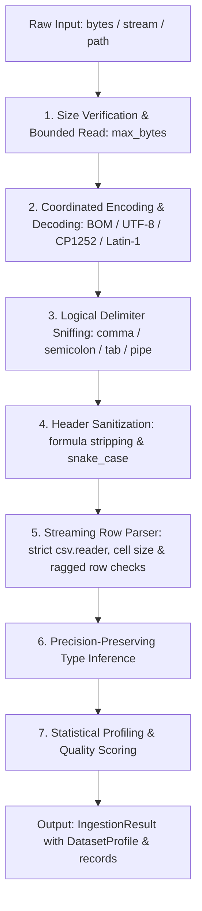

# Engineering Guide: CSV Ingestion and Profiling Engine

**Document Identifier:** `DOC-INGEST-003`
**Document Status:** Implementation Guide & Learning Reference
**Component:** `core/` (Analytical Core Ingestion & Profiling Foundation)
**Target Milestone:** Vertical Slice 1 (Component Delivery)
**Author / Project Lead:** Youssef Manssouri

---

## 1. Overview and Module Responsibilities

The `core/` package represents the pure Python domain core of Data Intelligence Lab. It has **zero dependencies** on web frameworks (`FastAPI`, `Starlette`), database servers, or user interfaces. It takes raw CSV inputs (bytes, streams, or file paths), applies strict security boundaries, normalizes untrusted headers, infers primitive types, and computes descriptive statistical profiles.

```text
core/
├── __init__.py           # Clean public domain API exports
├── types.py              # Data models, IngestionLimits, and sanitized domain exceptions
├── detection.py          # Deterministic encoding and delimiter sniffing
├── sanitization.py       # Header cleaning, identifier normalization, and formula injection defense
├── type_inference.py     # Precision-preserving primitive type inference
├── profiling.py          # Descriptive statistical calculations and 0-100 data quality scoring
└── ingestion.py          # Primary streaming ingestion orchestrator
```

### Module Responsibilities Breakdown

| Module | Primary Responsibility | Key Functions / Classes |
| :--- | :--- | :--- |
| **`core/types.py`** | Defines immutable data structures, resource limits, inference policy, and custom domain exceptions. | `IngestionLimits`, `InferencePolicy`, `DatasetProfile`, `ColumnProfile`, `DataQualityReport`, `IngestionResult`, `InferenceResult`, `IngestionError`, `SourceReadError`, `MalformedCSVError`, `CellSizeLimitExceededError`, `ParserFieldSizeLimitError`, `NumericRangeError`, `INFERENCE_DECISION_CODES` |
| **`core/detection.py`** | Coordinates deterministic character encoding selection/decoding and logical-record delimiter sniffing. | `detect_and_decode_encoding()`, `detect_delimiter()`, `detect_encoding()` |
| **`core/sanitization.py`** | Neutralizes spreadsheet formula injection, handles duplicate/empty column names, and normalizes headers into safe `snake_case` identifiers. | `normalize_headers()`, `sanitize_header_value()` |
| **`core/type_inference.py`** | Inspects column values and infers primitive types (`boolean`, `integer`, `float`, `date`, `datetime`, `string`) with IEEE-754 decimal exactness, temporal awareness rules, and deterministic decision tracking. | `infer_column_type()`, `is_null_value()`, `parse_boolean()`, `parse_integer()`, `parse_float()`, `parse_date()`, `parse_datetime()` |
| **`core/profiling.py`** | Calculates column-level statistics (min, max, mean, median, quartiles, IQR, standard deviation) with arithmetic range guards, and generates a 0–100 Data Health Score. | `profile_dataset()`, `profile_column()`, `calculate_numeric_stats()`, `compute_dataset_quality()` |
| **`core/ingestion.py`** | Main entry point coordinating bounded streaming acquisition, coordinated decoding, logical delimiter detection, streaming validation, ragged row detection, cell-size checks, inference policy resolution, and profiling. | `ingest_csv()` |

---

## 2. The End-to-End CSV Ingestion Lifecycle

The ingestion process follows an 8-step pipeline designed to fail early and safely before expensive operations take place:



### Step-by-Step Execution
1. **Bounded Input Acquisition (P2-03):** The input source (raw bytes, binary stream, or filesystem path) is read through a unified bounded reader in 64 KB chunks. If total bytes exceed `limits.max_bytes` (default 200 MB), ingestion halts immediately with `FileSizeLimitExceededError`. Filesystem paths use this same chunked reader to eliminate time-of-check to time-of-use (TOCTOU) bypasses. Expected metadata access failures (`path.is_file()`), file opening, and stream read errors are caught and converted to `SourceReadError` with paths sanitized to basename only, preventing internal directory or OS exception leakage. An `ExecutionDeadline` tracker is established at the start of ingestion.
2. **Coordinated Encoding Detection & Decoding (F04):** Operates on the already-bounded complete byte buffer. If a BOM is present (`utf-8-sig`, `utf-16-le`, `utf-16-be`), decoding is enforced strictly using that codec; invalid BOM-declared content raises `EncodingDetectionError` without fallback. The legacy `detect_encoding()` wrapper strictly enforces this same validation. In the absence of a BOM, deterministic precedence is applied over the complete input: strict UTF-8 first, strict CP1252 second, and Latin-1 as the final legacy fallback. Selected encoding and decoded text are returned together, avoiding redundant decode passes, and the raw byte buffer is released immediately.
3. **Logical-Record Delimiter Detection (F03, P2-01):** Parses the seekable decoded text stream using actual CSV parsing semantics (`quotechar='"'`, `doublequote=True`, `escapechar=None`, `skipinitialspace=False`, `strict=True`, `newline=""`). Candidate delimiters (`,`, `;`, `\t`, `|`) are evaluated: if exactly one candidate yields a multi-column header, it is selected; if multiple remain plausible, up to 10 logical records are inspected per candidate for structural consistency (ragged rows do not disqualify an otherwise uniquely consistent candidate, deferring to row validation). If ambiguous, `DelimiterDetectionError` is raised. If no valid multi-column interpretation exists, comma is strictly preserved as the canonical single-column convention; arbitrary alternative single-column fallback is eliminated so malformed comma CSVs (e.g. `a,"unclosed\n1,2\n`) are not disguised as 1-column semicolon/tab/pipe files. The text stream is rewound between candidate attempts and before final ingestion.
4. **Header Normalization:** Reads the first row. Strips formula injection characters (`=`, `+`, `-`, `@`), converts names to `snake_case`, handles empty headers (`unnamed_1`), and deduplicates duplicate names (`name`, `name_1`).
5. **Streaming Row Validation (F06, P2-02, P2-04):** Iterates record by record using Python's `csv.reader` with strict parser settings. Logical record numbers are tracked independently starting with header as logical record 1. Catches low-level `csv.Error` across both header reading and data iteration, translating syntax errors (e.g., unclosed quotes, unexpected characters after quote) into `MalformedCSVError` reporting the exact logical `row_number` (with physical `line_number` preserved separately) without fabricating column counts. Native parser field-size limit triggers (`csv.field_size_limit()`, default 128 KB) raise `ParserFieldSizeLimitError`, which identifies the native parser guard truthfully without falsely claiming a larger configured `max_cell_bytes` was exceeded and without fabricating byte counts or column indices. Measured cell-size limit violations exceeding configured `limits.max_cell_bytes` raise `CellSizeLimitExceededError` with exact measured byte counts. Any row whose column count differs from the header row immediately raises `MalformedCSVError` reporting the exact logical `row_number`. Duplicate rows are tracked using a running set of row hashes. Immediately upon completing row parsing, `text_stream.close()` is invoked and both `reader` and `text_stream` are deleted to ensure the underlying decoded text buffer is released before type inference begins.
6. **Precision-Preserving Type Inference (Phase 3):** Analyzes each column's non-null values against a strict type hierarchy using short-circuit generator checks, eliminating intermediate list allocations. Raw string column buffers are freed column-by-column as typed lists are populated. Periodic deadline polling (every 500 items) is enforced across candidate checks, conversion, timezone-awareness scanning, and literal preservation loops, ensuring large column scans abort early if the deadline is exceeded.
   - **Opt-in Literal Preservation (`InferencePolicy`):** If a normalized column name is listed in `inference_policy.preserve_as_text`, type inference is bypassed entirely. Null recognition is disabled, exact unstripped cell strings are preserved, `null_count=0`, inferred type is `"string"`, and decision code is `"PRESERVE_AS_TEXT"`. `InferencePolicy` validates member types and strictly rejects empty or whitespace-only column names (`ValueError("Column names in preserve_as_text cannot be empty.")`) immediately at construction time before any source acquisition. Passing unknown normalized column names during ingestion raises `ValueError("Unknown normalized column in preserve_as_text.")`.
   - **Conservative Float Inference & Scientific-Notation Integrity:** Requires exact decimal round-trip `Decimal(str(f)) == d`. Applies exact integral-value check (`int(f) == int(d)`) to every mathematically integral candidate (`d == d.to_integral_value()`) regardless of whether it uses scientific notation (`e`/`E`) or standard decimal formatting, detecting lossy float precision without integer corruption (e.g. `1e23` -> `"FLOAT_PRECISION_LOSS"`, while `1e20` -> `float`, `10**23` -> `integer`). Rejects mathematical non-finite tokens (`inf`, `-inf`, `infinity` -> `"NON_FINITE_FLOAT"`), nonzero underflow to `0.0` (`1e-400` -> `"FLOAT_UNDERFLOW"`), significant leading zeros on numeric patterns (`0123.4` -> `"LEADING_ZERO"`), and lossy IEEE-754 precision (`9007199254740993.0` -> `"FLOAT_PRECISION_LOSS"`). Missing value tokens in `NULL_REPRESENTATIONS` (`"nan"`, `""`, `"null"`, `"none"`, etc.) are converted to `None` during inference. Preserves IEEE `-0.0`. Fallback to string preserves original unstripped string values across the entire column.
   - **Strict Temporal Inference & Offset Validation:** Parses ISO-8601 `date` (with full calendar leap-year validation) and `datetime`. Validates timezone offset hours (`<= 23`) and minutes (`<= 59`) before parsing to reject invalid offsets (such as `+01:60` or `-00:99`) rather than allowing silent normalization. Aware datetimes preserve exact per-value UTC offsets without forced UTC normalization. Fractional seconds with <=6 digits are accepted as microsecond datetime precision. For >6 fractional digits, trailing zeroes beyond microseconds (e.g. `.123456000`) remain valid datetimes; values with non-zero information beyond microseconds (e.g. `.123456001`) fall back to string (`"SUBMICROSECOND_PRECISION"`). Columns mixing dates and datetimes fall back to string (`"MIXED_TEMPORAL_KINDS"`). Columns mixing naive and aware datetimes fall back to string (`"MIXED_AWARENESS"`).
   - **Deterministic Decision Codes & Precedence:** Every column metadata record includes `inference_policy_version: "1.0"` and an `inference_reason` from exactly 15 stable decision codes (7 typed: `PRESERVE_AS_TEXT`, `ALL_NULL`, `BOOLEAN`, `INTEGER`, `FLOAT`, `DATE`, `DATETIME`; 8 string fallback reasons: `LEADING_ZERO`, `FLOAT_PRECISION_LOSS`, `FLOAT_UNDERFLOW`, `NON_FINITE_FLOAT`, `MIXED_TEMPORAL_KINDS`, `SUBMICROSECOND_PRECISION`, `MIXED_AWARENESS`, `NO_UNIFORM_TYPE`). Precedence evaluates general text and mixed families to `NO_UNIFORM_TYPE`, and `MIXED_TEMPORAL_KINDS` before `MIXED_AWARENESS`. Governed by an isolated `INFERENCE_DECIMAL_CONTEXT` independent of caller-configured ambient Decimal traps and by a row-permutation determinism gate independent of row ordering. Header-only CSVs (0 data rows) receive `"ALL_NULL"`.
7. **Statistical Profiling with Range Guards (Phase 3):** Computes the five-number summary (min, Q1, median, Q3, max), mean, variance, and standard deviation for numeric columns, and character lengths for string columns. Sizeable loops poll the deadline periodically, including numeric input validation loops, and indivisible operations (`sorted()`) check the deadline immediately before and after.
   - **Narrow Range Guards:** Arithmetic operations (`input`, `mean`, `median`, `quartile`/`iqr`, `variance`, `std_dev`) are guarded against non-finite values, `OverflowError`, and `ValueError` (during `math.sqrt`). Odd-length median conversion is explicitly guarded against `OverflowError`. Range violations raise sanitized `NumericRangeError(operation=..., column_index=...)` with suppressed native exception chaining (`from None`).
   - **Timeout Precedence & Sanitization:** Deadlines are evaluated immediately before translating and raising range errors, ensuring `ProcessingTimeoutError` takes precedence over arithmetic errors. Error messages are sanitized to omit raw cell numbers.
   - **Reference Variance:** The exact reference variance baseline (`calculate_numeric_stats([1_000_000] + [0] * 10_000)["variance"] == 99990000.9999`) is strictly preserved.
8. **Quality Assessment:** Evaluates dataset completeness (percentage of non-null cells), uniqueness (percentage of distinct rows), and validity (penalizing constant columns) to calculate the composite 0–100 Data Health Score.

---

## 3. Key Python Concepts Used

For a developer learning Python, this codebase demonstrates several fundamental design patterns:

### 3.1 Validated Immutable Dataclasses (`@dataclass(frozen=True)`)
```python
@dataclass(frozen=True)
class IngestionLimits:
    max_bytes: int = 200 * 1024 * 1024
    max_rows: int = 1_000_000
    max_columns: int = 1_000
    max_cell_bytes: Optional[int] = None
    max_processing_seconds: float = 30.0

    def __post_init__(self) -> None:
        ...
```
- **What it is:** A dataclass automatically generates standard object methods. With `frozen=True`, instances are immutable.
- **Runtime Validation in `__post_init__`:** Explicit validation catches invalid configurations (zero, negative numbers, NaN, positive/negative infinity, booleans passed as integers, and impossible combinations such as `max_cell_bytes > max_bytes`) immediately at construction time.

### 3.2 Custom Exception Hierarchy
```python
class IngestionError(Exception):
    def __init__(self, message: str, code: str) -> None:
        super().__init__(message)
        self.code = code

class IngestionError(Exception):
    def __init__(self, message: str, code: str) -> None:
        super().__init__(message)
        self.code = code

class SourceReadError(IngestionError):
    """Raised when an open or read operation fails on a source path or stream."""
    def __init__(self, message: str) -> None:
        super().__init__(message, code="ERR_SOURCE_READ")

class MalformedCSVError(IngestionError):
    """Raised when CSV structure is invalid (ragged rows, unclosed quotes, syntax errors)."""
    def __init__(
        self,
        row_number: Optional[int] = None,
        expected_columns: Optional[int] = None,
        actual_columns: Optional[int] = None,
        message: Optional[str] = None,
    ) -> None:
        ...

class CellSizeLimitExceededError(IngestionError):
    ...
```
- **What it is:** Subclassing built-in `Exception` to create domain-specific errors with stable machine-readable codes.
- **Why it matters:** Allows caller code (such as a future FastAPI route handler) to catch `IngestionError` generically, or catch `FileSizeLimitExceededError` specifically to return HTTP 413, without exposing raw Python tracebacks, internal filesystem paths, or raw cell contents.

### 3.3 Streaming Chunk Processing
```python
chunk_size = 64 * 1024  # 64 KB
while True:
    if deadline:
        deadline.check()
    chunk = stream.read(chunk_size)
    if not chunk:
        break
    total_bytes += len(chunk)
    if total_bytes > max_bytes:
        raise FileSizeLimitExceededError(...)
    buffer.extend(chunk)
```
- **What it is:** Reading data in fixed-size blocks rather than loading unbounded streams into memory.
- **Why it matters:** Enforces the byte ceiling identically for bytes, binary streams, and filesystem paths before full parsing takes place.

### 3.4 Cooperative Execution Deadlines (`ExecutionDeadline`)
```python
class ExecutionDeadline:
    def __init__(self, timeout_seconds: float) -> None:
        self.start_time = time.monotonic()
        self.deadline = self.start_time + timeout_seconds

    def check(self) -> None:
        if time.monotonic() > self.deadline:
            raise ProcessingTimeoutError(...)
```
- **What it is:** A lightweight deadline tracker checked cooperatively at phase transitions and inside long-running loops (row streaming every 100 rows, type inference every 500 items, column profiling every 500 items, and record assembly every 100 rows, immediately post-assembly, and immediately pre-return).
- **Why it matters:** Ensures expensive operations fail deterministically when exceeding the execution budget.

### 3.5 Opt-In Literal Preservation & Typed Integrity (`InferencePolicy`)
```python
@dataclass(frozen=True)
class InferencePolicy:
    preserve_as_text: frozenset[str] = field(default_factory=frozenset)
```
- **What it is:** An immutable policy configuring column-level inference behavior. Runtime validation requires `preserve_as_text` to be a list, tuple, set, or frozenset of non-empty strings (rejecting invalid collection types with `TypeError` and rejecting empty or whitespace-only column names with `ValueError("Column names in preserve_as_text cannot be empty.")`), automatically cast to `frozenset[str]`.
- **Validation Lifecycle:** Validated pre-acquisition (rejecting non-`InferencePolicy` instances and invalid/empty policy entries before opening or reading any source) and resolved post-normalization. If any name in `preserve_as_text` does not match a normalized column name, `ValueError("Unknown normalized column in preserve_as_text.")` is raised immediately.
- **Literal Preservation:** Columns matching `preserve_as_text` bypass type inference and null recognition. Original unstripped strings are preserved, `null_count=0`, and metadata reports `inferred_type="string"`, `inference_reason="PRESERVE_AS_TEXT"`, `inference_policy_version="1.0"`. Periodic deadline polling is enforced during the literal preservation loop, followed by an immediate post-operation check.

### 3.6 Numeric Range Guards and Error Sanitization (`NumericRangeError`)
```python
class NumericRangeError(IngestionError):
    def __init__(self, operation: str, column_index: Optional[int] = None) -> None:
        ...
```
- **What it is:** A specialized domain error raised when statistical calculations (`input`, `mean`, `median`, `quartile`, `iqr`, `variance`, `std_dev`) overflow IEEE-754 range or encounter non-finite inputs. Odd-length median conversion `float(sorted_vals[mid])` and square root calculations (`OverflowError` and `ValueError`) are specifically guarded.
- **Sanitized Contract:** Never leaks raw numbers, memory addresses, or unparsed cells into exception text. Native exception chaining is suppressed (`from None`). The message strictly matches `^Numeric calculation exceeded representation limits (?:in column (?P<col>\d+) )?during '(?P<op>[a-z_]+)'\.$`.
- **Timeout Precedence:** Deadline checks precede arithmetic range errors, ensuring execution timeouts take priority over numeric overflow during large dataset profiling.

---

## 4. Security Rules, Threat Mitigations, and Resource Model

| Threat Vector | Failure Scenario | Architectural Defense in `core/` |
| :--- | :--- | :--- |
| **Denial of Service (Memory Exhaustion)** | User uploads a 5 GB file, exhausting host RAM. | `FileSizeLimitExceededError` enforced during streaming read before the file is parsed. |
| **Path Read Bypass / TOCTOU Growth** | File grows between size-check and read, or special pipe is opened. | `_read_and_validate_stream()` routes file paths through the bounded chunk reader. |
| **Source Read / Metadata / Unreadable Stream (P2-03)** | File permissions fail during metadata access (`path.is_file()`), open, or stream read raises OS error. | `SourceReadError` catches expected OS/stream read errors, sanitizing paths to basename only and suppressing raw OS exception messages. |
| **CSV Expansion Bomb (Decompression Attack)** | A 10 MB CSV contains a single cell with 100 million characters designed to exhaust string memory. | `CellSizeLimitExceededError` checks every individual cell against `max_cell_bytes = 32 * 1024` (32 KB limit) and reports exact measured byte lengths. |
| **Native Parser Field Size Exceeded (P2-04)** | An input field exceeds the Python CSV native parser limit (`csv.field_size_limit()`, default 128 KB). | `ParserFieldSizeLimitError` (subclass of `CellSizeLimitExceededError`) truthfully identifies native parser limit failure without falsely claiming configured `max_cell_bytes` was exceeded and without fabricating column/byte metadata. |
| **CSV / Formula Injection (CWE-1236)** | Malicious CSV header contains `=cmd\|' /C calc'!A0`. When opened in Excel, it executes malicious commands. | `sanitize_header_value()` strips leading `=+-@\t\r` characters, neutralizing formula execution. |
| **Data Corruption (Silent Truncation)** | ZIP codes (e.g., `"01234"`) are parsed as integers, silently converting them to `1234`. | `has_significant_leading_zero()` detects multi-digit numbers starting with `"0"` and forces them to remain `string`. |
| **Ragged Rows / Misalignment** | Row 50 has 4 columns instead of 3, causing column data to shift silently into wrong categories. | `MalformedCSVError` halts ingestion immediately and reports the exact logical row number. |
| **CSV Parser Syntax Errors (P2-02)** | Unclosed quotes, unexpected characters after quote, or blank data rows cause parser confusion. | `MalformedCSVError` catches low-level `csv.Error`, reporting consistent 1-based logical `row_number` (preserving physical `line_number` separately) without leaking cell payloads or fabricating column counts. |
| **Malformed Single-Column Reinterpretation (P2-01)** | Malformed comma header (e.g., `a,"unclosed\n1,2\n`) fails comma parsing but might pass as single-column under another delimiter. | `detect_delimiter()` enforces canonical comma convention when no multi-column interpretation exists, eliminating arbitrary alternative single-column fallback and surfacing the true syntax error. |
| **Delimiter Ambiguity / Fragile Sniffing** | Mixed delimiters or multiline quoted fields fool simple frequency heuristics. | `detect_delimiter()` strictly parses logical records using CSV semantics across candidates and raises `DelimiterDetectionError` if ambiguous. |
| **Runaway Execution / ReDoS** | Complex regex evaluation or massive row counts stall the process indefinitely. | `ExecutionDeadline` cooperatively raises `ProcessingTimeoutError` across all pipeline phases with bounded polling. |
| **Invalid Configuration** | Caller passes NaN, negative timeout, or impossible cell boundaries. | `IngestionLimits.__post_init__` validates all parameters and rejects invalid combinations immediately. |
| **Information Disclosure** | Error messages leak internal paths (e.g., `C:\Users\Admin\...`) or raw passwords from the file. | Exception messages report row and column coordinates and byte counts, never raw cell content or full file paths. |

### 4.1 Explicit Resource Model & Boundary Commitments

#### Hard Guarantees (Enforced by `core/`)
1. **Source Byte Ceiling:** Every input source (`bytes`, `BinaryIO`, and filesystem `Path`) respects `limits.max_bytes`. Exceeding inputs halt acquisition deterministically.
2. **Cell Size Ceiling:** Individual cells exceeding `limits.max_cell_bytes` (default 32 KB) are rejected with `CellSizeLimitExceededError`.
3. **Row & Column Ceilings:** Header columns exceeding `limits.max_columns` and data rows exceeding `limits.max_rows` raise corresponding domain exceptions.
4. **Limits Validation:** `IngestionLimits` rejects non-integers, booleans, negative numbers, zero, NaN, infinity, and impossible combinations (`max_cell_bytes > max_bytes`) on construction.
5. **Safe Exceptions:** Exception messages never expose directory structures, OS error codes, or unparsed cell values.
6. **Final Deadline Verification:** The shared execution deadline is checked during record assembly, immediately after assembly, and immediately before returning `IngestionResult`, ensuring deadline expiry during assembly cannot return success.

#### Best-Effort Protections (Mitigations)
1. **Memory Amplification Reduction:**
   - Internal raw bytes are deleted immediately after character decoding (note: caller-owned input byte arrays or file objects remain under caller lifetime).
   - Internal decoded text buffer and text stream are closed and freed immediately after row extraction completes, along with the exhausted `csv.reader` reference.
   - Column candidate type checks use short-circuit evaluation rather than allocating intermediate lists of size $N$ per candidate check.
   - Null counts are tracked directly within the already-polled conversion and fallback loops, eliminating separate full-column scans.
   - Raw string column lists are popped and freed sequentially as typed lists are produced.
   - Duplicate rows are counted with a running hash set, eliminating the auxiliary $N$-element hash list.
2. **Cooperative Timeout Propagation & Polling:**
   - `ExecutionDeadline` is checked at chunk reading, encoding detection, row parsing (every 100 rows), per-column transitions, inside record assembly (every 100 rows), immediately after record assembly, and immediately before returning `IngestionResult`.
   - Periodic polling (every 500 items) is enforced during sizeable type inference loops (non-null scanning, candidate matching, typed conversion, fallback string conversion, timezone-awareness scanning, and literal preservation) and profiling loops (numeric input boundary validation, numeric variance calculation, string length calculation, and column-level non-null filtering).
   - Indivisible operations such as built-in sort (`sorted()`) and literal-copy arrays check the deadline immediately before and after execution.

#### Architectural Limitations & Future Isolation Requirements
1. **Full Materialization Requirement:** The analytical contract of `IngestionResult` returns `records: List[Dict[str, Any]]` and computes exact five-number summaries via sorting. As a result, pure-Python heap memory scales with dataset size ($O(N)$) and does NOT have a constant $O(1)$ RAM ceiling. A true memory-bounded pipeline requires streaming quantile sketches (e.g. T-Digest, HyperLogLog) or direct disk/Arrow serialization.
2. **Process Isolation Requirement for Deadlines:** Cooperative deadline checks cannot pre-emptively interrupt blocking kernel I/O, OS reads, or low-level C calls while executing. A true hard execution deadline requires process isolation (e.g., isolated worker child processes with OS signal termination), which belongs at the future runtime / API server boundary.
3. **Non-BOM UTF-8 Indistinguishability:** In the absence of a Byte Order Mark, deterministic precedence attempts UTF-8 before CP1252 and Latin-1. Because UTF-8 validation checks byte sequence structure, a malformed UTF-8 payload without a BOM may happen to consist of bytes that represent valid codepoints in CP1252 or Latin-1. In such cases, the text cannot be programmatically distinguished from legitimate legacy-encoded text without caller guidance or statistical language models.
4. **Parser Dialect Strictness & Native Guard:** Python's `strict=True` is not complete RFC 4180 conformance. Literal quotes inside unquoted fields remain preserved according to Python's csv dialect rules, and alternative escaping schemes (such as backslash escaping) are not supported. Furthermore, the native parser guard `csv.field_size_limit()` (default 128 KB) is a global process setting and is not mutated per-ingestion call.
5. **Explicit Non-Claims:** The component does NOT claim that the 100 MB / 5-second performance target has been achieved, does NOT claim complete memory safety, and does NOT claim OWASP ASVS compliance.

---

## 5. The 100 MB vs. 200 MB Decision & Benchmark Plan

### Discrepancy Identified
- [`docs/01-product-definition.md` §7.1](01-product-definition.md#71-ingestion--normalization-criteria) states: *"Successfully parses standard CSV files up to 100 MB in size within 5 seconds on a standard modern quad-core laptop."*
- [`docs/02-architecture.md` §10.4](02-architecture.md#104-stride-threat-matrix--verification-requirements) states: *"200MB max file size; 32KB max cell limit... 30s query timeout."*

### Resolution & Architectural Decision
- **200 MB is the Security Rejection Boundary:** Files exceeding 200 MB are rejected immediately to protect system stability.
- **100 MB is the Performance Target:** Files up to 100 MB are targeted to complete parsing within the 5-second responsive window.
- **Limits are Configurable:** Developers can adjust limits via `IngestionLimits(max_bytes=...)` based on deployment environment capabilities.

### Proposed Benchmark Suite (Pre-Implementation Plan)
To empirically verify the 100 MB / 5-second target before release:
1. Generate synthetic CSV fixtures at 1 MB, 10 MB, 50 MB, 100 MB, and 200 MB with 10 numeric and 10 string columns.
2. Measure wall-clock execution time and peak memory delta using Python's `tracemalloc`.
3. If pure-Python streaming parsing on 100 MB files exceeds 5 seconds, profile the hotspot and evaluate delegating the parsing pass to `pyarrow.csv.read_csv` with Python-level pre-validation.

---

## 6. What the Tests Prove vs. What They Do Not Prove

### What the 188 Automated Tests Prove
The test suite consists of **188 automated tests** (74 Phase 1 regression tests in `test_ingestion.py`, 47 Phase 2 parsing/adversarial tests in `test_phase2_parsing.py`, 37 Phase 3 type inference tests in `test_type_inference.py`, 14 Phase 3 profiling tests in `test_profiling.py`, and 16 Phase 3 policy and integration tests in `test_inference_policy.py`):

#### Phase 1 Resource-Safety Baseline (74 Tests)
- Bounded reading enforces `max_bytes` on exact limit, 1-byte over, bytes, streams, growing streams, and filesystem paths (including `test_byte_limit_filesystem_path_input`).
- Exhausted `csv.reader` and `StringIO` text buffers are closed and freed immediately after parsing, releasing the internal decoded text buffer before type inference (proven via weak reference probe).
- Deadline expiry during record assembly or before return raises `ProcessingTimeoutError` instead of returning success (proven via deterministic mock clocks during active record assembly and pre-return hook).
- Type inference polls deadline every 500 items during candidate matching, typed conversion, and string fallback, aborting early without unpolled full-column null scans.
- Profiling polls deadline during numeric variance (proven to abort after variance work has actively begun), string length calculations, and column filtering.
- Numeric profiling preserves the reference variance result (`99990000.9999`) for high-variance distributions.
- `IngestionLimits` rejects zero, negative, NaN, infinity, invalid types, and impossible combinations.
- Missing values and duplicate rows are counted correctly and penalize the quality score.
- Error messages do not leak local paths or sensitive cell payloads.

#### Phase 2 Parsing Correctness & Contract Tightening (47 Tests)
- **P2-01 Malformed Header Rejection & Canonical Delimiter Handling:**
  - `b'a,"unclosed\n1,2\n'` is rejected with `MalformedCSVError` and not reinterpreted as a 1-column semicolon/tab/pipe dataset.
  - Candidate order permutation does not alter single-column canonical comma behavior.
  - Single-column files correctly default to comma convention.
  - Valid multi-column files using semicolon, tab, and pipe delimiters continue to work.
  - Multiline quoted fields with embedded LF and CRLF work across all delimiters (`,`, `;`, `\t`, `|`).
  - Structural delimiter ambiguity raises `DelimiterDetectionError`.
  - `detect_delimiter(sample_text=...)` keyword compatibility is preserved.
- **P2-02 Consistent Logical Record Numbering:**
  - Syntax errors following multiline quoted records report logical record numbering (e.g. row 3), preserving physical line count separately (`line_number=5`).
  - Unclosed multiline records report consistent logical record numbering.
  - Ragged rows at equivalent logical positions report identical row numbers as syntax errors.
  - Header counts consistently as logical record 1.
  - Backwards compatibility for `MalformedCSVError(5, 3, 4)` 3-argument construction is preserved.
- **P2-03 Filesystem Metadata Error Sanitization:**
  - Simulated `Path.is_file()` metadata permission failure raises sanitized `SourceReadError` reporting basename only without leaking directory paths or raw OS exception text.
  - Simulated open permission failure raises sanitized `SourceReadError`.
  - Missing file paths raise `FileNotFoundError` with sanitized basename only.
  - Unreadable stream failures raise `SourceReadError`.
  - Unrelated programmer errors (e.g. invalid object types) propagate unchanged as `AttributeError`.
  - Sentinel tokens and passwords never appear in error messages.
- **P2-04 Native Parser Guard vs. Configured Byte Limit:**
  - Fields exceeding native parser guard (131,072) while below configured `max_cell_bytes` (200,000) produce `ParserFieldSizeLimitError` identifying the native guard without claiming the configured limit was exceeded, and retaining unknown actual-size and column attributes as `None`.
  - Genuine configured byte ceiling violations measure and report exact cell byte size, column index, and `max_cell_bytes`.
  - Header native parser guard failures are handled truthfully at row 1.
- **F04 Encoding Precedence & Late-Byte Verification:**
  - Multi-byte UTF-8 sequences split across byte 65,536 decode strictly as UTF-8.
  - Byte split offsets -2, -1, 0, +1, +2 around 65,536 decode cleanly.
  - UTF-8 and UTF-16 BOMs decode strictly; invalid content following BOM raises `EncodingDetectionError` without fallback.
  - CP1252-specific byte strictly beyond offset 65,536 (offset 66,008) selects CP1252 rather than Latin-1.
  - Unassigned CP1252 bytes fall back to Latin-1.
  - Deadline checks are verified directly during decoding helper execution.

#### Phase 3 Typed-Value Integrity & Inference Policy (67 Tests)
- **P3-V01 Scientific-Notation Numeric Integrity:**
  - The exact integral-value check applies to every mathematically integral decimal candidate (`d == d.to_integral_value()`), regardless of whether the representation contains `e`/`E` or standard decimal notation.
  - Exponential representations losing exact integer value (`1e23`, `1E23`, `-1e23`) fall back to string (`FLOAT_PRECISION_LOSS`), preventing integer corruption.
  - Non-corrupting scientific notation (`1e20`, `1.5e2`, `1.5e-1`) is correctly accepted as float.
  - Equivalent mathematical representations (`1e23`, `1E23`, `10**23.0`) produce consistent typed values.
  - Negative zero (`-0.0`) is preserved without stripping the sign.
- **P3-V02 Temporal Validation (Offsets & Fractional Precision):**
  - Timezone offset components are explicitly validated (`tz_hour <= 23` and `tz_minute <= 59`) before parsing, rejecting invalid offsets (`+01:60`, `-00:99`) instead of allowing silent normalization.
  - Fractional seconds with <=6 digits are accepted as microsecond datetime precision.
  - For >6 digits, trailing zeroes beyond microsecond precision (`.123456000`, `.123456000000`) remain valid datetimes.
  - Non-zero information beyond microseconds (`.123456001`) falls back to string (`SUBMICROSECOND_PRECISION`).
- **P3-V03 Numeric Profiling Range Handling & Exception Contracts:**
  - Odd-length median conversion `float(sorted_vals[mid])` is guarded against `OverflowError`, translating to sanitized `NumericRangeError(operation="median")`.
  - Standard deviation calculation guards both `OverflowError` and `ValueError` (during `math.sqrt`).
  - Native exception chaining is suppressed (`from None` with `__suppress_context__ = True`) on public error translations.
  - Shared execution deadlines are evaluated immediately before raising range errors, ensuring `ProcessingTimeoutError` takes precedence over arithmetic exceptions.
  - Error messages strictly match `^Numeric calculation exceeded representation limits (?:in column (?P<col>\d+) )?during '(?P<op>[a-z_]+)'\.$`.
- **P3-V04 Cooperative Deadline Polling:**
  - Timezone-awareness scanning loop in `infer_column_type` polls the deadline periodically.
  - Numeric input boundary validation loop in `calculate_numeric_stats` polls the deadline periodically.
  - Literal-preservation copy loop in `infer_column_type` polls periodically, with an immediate post-operation check.
- **P3-V05-R1 / P3-V05-R1-U01 Equivalent Underflow Representations (ASCII & Unicode):**
  - Mathematically equivalent underflow representations across both ASCII and Unicode decimal digits (`1e-400`, `١e-400`, `１e-400`, `0.١e-399`, `0.<399 zeros>1`, `0.<399 zeros>١`, `-1e-400`, `-0.<399 zeros>1`, `1.0e-400`, `+1e-400`, `.0<398 zeros>1`) are recognized via representation-aware mantissa non-zero digit inspection (`has_nonzero_decimal_digit` using `unicodedata.decimal`) and uniformly classified as `FLOAT_UNDERFLOW` without lossy float conversions.
- **P3-U02 Unicode Decimal Leading Zero Preservation:**
  - Leading decimal zeros across the entire supported Unicode decimal digit repertoire (e.g. `٠١٢٣`, `０１２３`, `+٠١٢٣`, `٠1.2`, `٠e-400`) are recognized using `unicodedata.decimal` and preserved as string (`LEADING_ZERO`), preventing loss of significant formatting.
- **P3-U03 Complete Temporal Candidate Syntax Validation:**
  - Date and datetime candidate validation requires valid ISO-8601 ASCII digit components before precision truncation. Unsupported datetime representations with Unicode digits (such as `2024-01-01T00:00:00.123456\u0660`) fail candidate syntax validation and fall back accurately to `NO_UNIFORM_TYPE` without false temporal evidence.
- **P3-V05-R2 Mixed Candidate Families & Precedence:**
  - Candidate families (`boolean`, `numeric`, `temporal`) are tracked at the column level. Columns containing incompatible recognized candidate families (e.g. `["1e309", "2024-01-01"]`, `["true", "1e309"]`, `["true", "42"]`) evaluate to `NO_UNIFORM_TYPE`.
- **Temporal Edge Cases & Precedence:**
  - Temporal candidate kind evidence survives conversion failures. Columns mixing date and datetime candidates (even when datetime has submicrosecond precision, e.g. `["2024-01-01", "2024-01-01T00:00:00.123456001"]`) evaluate to `MIXED_TEMPORAL_KINDS` across all row permutations.
  - Reconciled catalog contains exactly 15 decision codes in `INFERENCE_DECISION_CODES`.
- **P3-V06 InferencePolicy Structural Validation & Zero-Source Acquisition:**
  - `InferencePolicy` validates container types (`list`, `tuple`, `set`, `frozenset`) and strictly rejects empty or whitespace-only column names (`ValueError("Column names in preserve_as_text cannot be empty.")`) during construction.
  - Pre-acquisition validation occurs inside `ingest_csv` before opening or reading any stream or filesystem path, guaranteeing zero source acquisition on invalid policy.

### What the Tests Do NOT Prove (Residual Risks)
- **High-throughput performance:** The test suite uses small fixtures (<1 MB); it does not prove 100 MB files complete in under 5 seconds on all hardware.
- **Complete RAM Ceiling:** Tests do not prove constant memory consumption. Full materialization remains in memory ($O(N)$).
- **Pre-emptive OS Interruption:** Tests prove cooperative deadline handling, not pre-emptive interruption of arbitrary blocking OS operations or indivisible C calls while executing.
- **OWASP ASVS Level 2 Compliance:** Passing unit tests does not constitute a formal security audit.
- **Non-Standard CSV Dialects:** CSV files with unusual escape characters (e.g., `\` instead of `""`) or inconsistent quotation may require manual delimiter/dialect configuration in future milestones.

---

## 7. How to Run Tests and Exercise the Component

### 7.1 Running the Automated Test Suite
From the project root directory:

```powershell
# Activate the virtual environment
.\.venv\Scripts\Activate.ps1

# Run the full test suite with verbose output and cache provider disabled
.\.venv\Scripts\pytest.exe -v -p no:cacheprovider
```

Expected output:
```text
tests/unit/test_ingestion.py::test_normal_csv_mixed_types PASSED
tests/unit/test_ingestion.py::test_empty_file_raises_error PASSED
...
tests/integration/test_inference_policy.py::test_p3_v06_zero_source_acquisition_filesystem_path PASSED
============================ 188 passed in 8.71s =============================
```

### 7.2 Manually Exercising the Component in Python
You can test the ingestion engine directly in an interactive Python terminal:

```python
from core import ingest_csv

# Test with a raw CSV string
csv_data = b"product,price,in_stock\nLaptop,999.99,true\nMouse,24.50,false\nKeyboard,,true\n"
result = ingest_csv(csv_data)

# Inspect the dataset profile
print(f"Rows: {result.profile.row_count}")
print(f"Columns: {result.profile.column_count}")
print(f"Health Score: {result.profile.quality.overall_score}/100")

# Inspect column profiles
for col in result.profile.columns:
    print(f"Column: {col.name} ({col.inferred_type}) - Nulls: {col.null_count}")

# Inspect normalized records
print(f"First record: {result.records[0]}")
```
